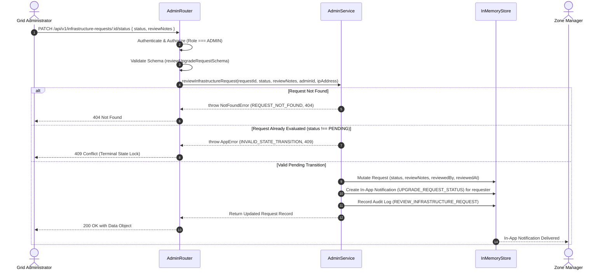

# Admin Audit, Notification Monitoring, and Upgrade-Request Decisions (Phase 22)

---

## 1. Executive Summary

Phase 22 delivers the governance, regulatory compliance, and capital investment decision tier for the National Load Shedding & Power Outage Management System. 

It equips system administrators (`ADMIN` role) with complete oversight of administrative actions, real-time communication telemetry, and formal decision-making authority over field infrastructure upgrade requests submitted by Zone Managers.

Phase 22 implements:
1. **Security Audit Trail Explorer (`GET /api/v1/admin/audit-logs`)**: Canonical Endpoint 80 for querying the tamper-evident administrative event journal with multi-factor filters (actor, action, target entity, timestamp ranges, and IP address) and paginated outputs.
2. **Notification Delivery Telemetry & Health Monitoring (`GET /api/v1/admin/notifications`)**: Real-time communication pipeline telemetry calculating delivery success rates, channel breakdowns, and status distribution across SMS and in-app channels.
3. **Infrastructure Upgrade Decision Engine (`PATCH /api/v1/infrastructure-requests/:id/status`)**: Canonical Endpoint 81 enabling Grid Admins to approve or reject capital equipment upgrade requests, enforcing terminal state immutability, dispatching real-time in-app decision notifications to submitting Zone Managers, and automatically logging the review action in the audit trail.

---

## 2. Architectural Overview and Workflow

```
                                      ┌─────────────────────────────────────────┐
                                      │              GRID ADMIN                 │
                                      └────────────────────┬────────────────────┘
                                                           │
               ┌───────────────────────────────────────────┼───────────────────────────────────────────┐
               │                                           │                                           │
               ▼                                           ▼                                           ▼
┌─────────────────────────────┐             ┌─────────────────────────────┐             ┌─────────────────────────────┐
│  Security Audit Explorer    │             │   Notification Telemetry    │             │   Upgrade Decision Engine   │
│  GET /api/v1/admin/audit-logs│             │  GET /api/v1/admin/notifs   │             │ PATCH /infrastructure-      │
│  • Multi-factor filtering   │             │  • Delivery Success Rate %  │             │       requests/:id/status   │
│  • Actor, Action, Entity    │             │  • Delivery Status Counts   │             │  • Terminal state guard     │
│  • Strict ADMIN RBAC        │             │  • Backward-compatible mode │             │  • Zone Manager Alert       │
└──────────────┬──────────────┘             └──────────────┬──────────────┘             └──────────────┬──────────────┘
               │                                           │                                           │
               ▼                                           ▼                                           ▼
┌─────────────────────────────┐             ┌─────────────────────────────┐             ┌─────────────────────────────┐
│      InMemoryStore          │             │      InMemoryStore          │             │ 1. Mutate Status & Decision │
│      .auditLogs[]           │             │      .notifications[]       │             │ 2. Create in-app Alert      │
└─────────────────────────────┘             └─────────────────────────────┘             │ 3. Record Audit Log         │
                                                                                        └──────────────┬──────────────┘
                                                                                                       │
                                                                                                       ▼
                                                                                        ┌─────────────────────────────┐
                                                                                        │        ZONE MANAGER         │
                                                                                        │ In-App Notification Alert   │
                                                                                        └─────────────────────────────┘
```

### 2.1 Upgrade Request Decision Workflow



---

## 3. Canonical REST API Specifications

### 3.1 Endpoint 80: Security Audit Trail Explorer
- **Route**: `GET /api/v1/admin/audit-logs` (Aliases: `GET /api/admin/audit-logs`)
- **Authorization**: `Bearer <token>` (`ADMIN` role strictly enforced; non-admins receive `403 Forbidden`).
- **Query Parameters**:
  | Parameter | Type | Required | Description |
  | :--- | :--- | :--- | :--- |
  | `actorId` | `string` | No | Filter logs by the unique ID of the performing user. |
  | `action` | `string` | No | Filter logs by action code (e.g. `USER_CREATED`, `REVIEW_INFRASTRUCTURE_REQUEST`). |
  | `entity` | `string` | No | Filter logs by target entity type (`USER`, `FEEDER`, `SCHEDULE`, `INFRASTRUCTURE_REQUEST`). |
  | `entityId` | `string` | No | Filter logs by target entity ID. |
  | `startDate` | `ISO8601 string` | No | Logs created at or after this timestamp. |
  | `endDate` | `ISO8601 string` | No | Logs created at or before this timestamp. |
  | `ipAddress` | `string` | No | Filter logs by origin client IP address. |
  | `page` | `integer` | No | Page number (default: `1`). |
  | `pageSize` | `integer` | No | Page size (default: `20`, max: `100`). |

#### Response (`200 OK`):
```json
{
  "success": true,
  "statusCode": 200,
  "message": "Audit logs retrieved successfully",
  "data": [
    {
      "id": "audit_1793466824190_abc",
      "actorId": "usr_admin_01",
      "actorEmail": "admin@nationalgrid.gov.bd",
      "actorRole": "ADMIN",
      "action": "REVIEW_INFRASTRUCTURE_REQUEST",
      "entity": "INFRASTRUCTURE_REQUEST",
      "entityId": "req_1793466824100_xyz",
      "ipAddress": "192.168.1.10",
      "details": {
        "status": "APPROVED",
        "reviewNotes": "Approved for Q4 capital expenditure."
      },
      "createdAt": "2026-10-31T17:10:00.000Z"
    }
  ],
  "meta": {
    "page": 1,
    "pageSize": 20,
    "total": 1,
    "totalPages": 1
  }
}
```

---

### 3.2 Notification Delivery Telemetry & Monitoring
- **Route**: `GET /api/v1/admin/notifications` (Aliases: `GET /api/admin/notifications`)
- **Authorization**: `Bearer <token>` (`ADMIN` role strictly enforced).
- **Query Parameters**:
  | Parameter | Type | Required | Description |
  | :--- | :--- | :--- | :--- |
  | `status` | `DeliveryStatus` | No | Filter by `QUEUED`, `SENDING`, `SENT`, `DELIVERED`, `FAILED`. |
  | `channel` | `NotificationChannel` | No | Filter by `SMS`, `EMAIL`, `IN_APP`, `PUSH`. |
  | `telemetry` | `boolean` | No | When `true`, returns delivery rate analytics and breakdown object. |
  | `page` | `integer` | No | Page number (default: `1`). |
  | `pageSize` | `integer` | No | Page size (default: `50`, max: `200`). |

#### Telemetry Response (`200 OK` with `?telemetry=true`):
```json
{
  "success": true,
  "statusCode": 200,
  "message": "Notification delivery telemetry retrieved successfully",
  "data": {
    "totalLogged": 450,
    "deliveredCount": 420,
    "sentCount": 10,
    "failedCount": 15,
    "queuedCount": 5,
    "deliverySuccessRate": 93.33,
    "items": [
      {
        "id": "notif_1793466824195_pqr",
        "userId": "usr_mgr_01",
        "title": "Infrastructure Upgrade Request Approved",
        "message": "Your request for feeder Dhanmondi-02 was APPROVED.",
        "type": "UPGRADE_REQUEST_STATUS",
        "channel": "IN_APP",
        "deliveryStatus": "DELIVERED",
        "read": false,
        "createdAt": "2026-10-31T17:10:00.000Z"
      }
    ]
  }
}
```

$$\text{Delivery Success Rate} = \frac{\text{deliveredCount} + \text{sentCount}}{\text{totalLogged}} \times 100\%$$

*Note: If `telemetry=true` is omitted, the endpoint operates in backward-compatible array mode, returning `data: NotificationRecord[]` to satisfy legacy test assertions.*

---

### 3.3 Endpoint 81: Infrastructure Upgrade Decision Engine
- **Route**: `PATCH /api/v1/infrastructure-requests/:id/status` (Aliases: `PATCH /api/infrastructure-requests/:id/status`, `PATCH /api/v1/admin/infrastructure-requests/:id/status`)
- **Authorization**: `Bearer <token>` (`ADMIN` role strictly enforced).
- **Request Body**:
  ```json
  {
    "status": "APPROVED",
    "reviewNotes": "Approved for Q4 capital expenditure."
  }
  ```
  *(Allowed values for `status`: `APPROVED` or `REJECTED`. `reviewNotes` is mandatory with $\ge 5$ characters).*

#### Response (`200 OK`):
```json
{
  "success": true,
  "statusCode": 200,
  "message": "Infrastructure request evaluated successfully",
  "data": {
    "id": "req_1793466824100_xyz",
    "feederId": "feeder_dhaka_01",
    "feederName": "Dhanmondi Road 27 Feeder",
    "zoneId": "zone_dhaka_central",
    "requesterId": "usr_mgr_01",
    "requesterName": "Zone Manager Dhaka Central",
    "reason": "Repeated transformer overload during peak hours.",
    "urgency": "HIGH",
    "status": "APPROVED",
    "reviewNotes": "Approved for Q4 capital expenditure.",
    "reviewedBy": "usr_admin_01",
    "reviewedAt": "2026-10-31T17:10:00.000Z",
    "createdAt": "2026-10-31T16:00:00.000Z",
    "updatedAt": "2026-10-31T17:10:00.000Z"
  }
}
```

#### Error Responses:
- **`404 Not Found` (`REQUEST_NOT_FOUND`)**: Target infrastructure upgrade request does not exist.
- **`409 Conflict` (`INVALID_STATE_TRANSITION`)**: Request has already been evaluated (`status !== PENDING`). Once decided, infrastructure requests are terminal and immutable.

---

## 4. State Machine and Transition Guardrails

```
             ┌─────────────────────────┐
             │         PENDING         │
             └────────────┬────────────┘
                          │
            Grid Admin Evaluation Decision
                          │
            ┌─────────────┴─────────────┐
            ▼                           ▼
┌─────────────────────────┐ ┌─────────────────────────┐
│        APPROVED         │ │        REJECTED         │
│   (Terminal & Locked)   │ │   (Terminal & Locked)   │
└─────────────────────────┘ └─────────────────────────┘
```

1. **Terminal State Immutability**:
   Once a request transitions out of `PENDING` into `APPROVED` or `REJECTED`, subsequent review attempts are permanently blocked with `409 Conflict`:
   $$\text{Current State } \neq \texttt{PENDING} \implies \text{Reject with HTTP 409}$$
2. **Requester Notification Side Effect**:
   Every successful review transition immediately creates an in-app notification directed to the submitting Zone Manager (`request.requesterId`):
   $$\text{Type: } \texttt{NotificationType.UPGRADE\_REQUEST\_STATUS}, \quad \text{Channel: } \texttt{NotificationChannel.IN\_APP}$$
3. **Audit Journal Side Effect**:
   Every evaluation decision is synchronously journaled in the audit store with:
   $$\text{Action: } \texttt{"REVIEW\_INFRASTRUCTURE\_REQUEST"}, \quad \text{Entity: } \texttt{"INFRASTRUCTURE\_REQUEST"}$$

---

## 5. Verification and Automated Test Results

Phase 22 is comprehensively covered by automated test suite **Test 29 (29a–29h)** in `apps/api/src/test/runner.ts`:

| Test Code | Description | Assertion Criteria |
| :--- | :--- | :--- |
| **Test 29a** | Audit Log Pagination & Query | Validates `GET /api/v1/admin/audit-logs?page=1&pageSize=5` returns structured items and meta pagination. |
| **Test 29b** | Multi-factor Audit Log Filtering | Filters by `actorId` and `action=REVIEW_INFRASTRUCTURE_REQUEST`; verifies 100% matched records. |
| **Test 29c** | Audit Log Date Range Filter | Filters by `startDate` and `endDate`; verifies timestamps fall strictly within the window. |
| **Test 29d** | Audit Log RBAC Protection | Verifies non-admin (Zone Manager) receives `403 Forbidden` on `/api/v1/admin/audit-logs`. |
| **Test 29e** | Notification Delivery Telemetry | Verifies `?telemetry=true` calculates delivery counts and accurate `deliverySuccessRate` percentage. |
| **Test 29f** | Upgrade Request Approval | Verifies `PATCH /api/v1/infrastructure-requests/:id/status` approves request, records notes, alerts Zone Manager, and records audit log. |
| **Test 29g** | Terminal State Guard | Verifies subsequent review of already approved/rejected request is rejected with `409 Conflict`. |
| **Test 29h** | Non-Existent Request Guard | Verifies review of invalid request ID returns `404 REQUEST_NOT_FOUND`. |

### Execution Output:
```
==========================================
🏁 Test Summary: 265 PASSED, 0 FAILED
==========================================
```
All 265 automated test cases in the test runner pass cleanly without warnings or errors.
