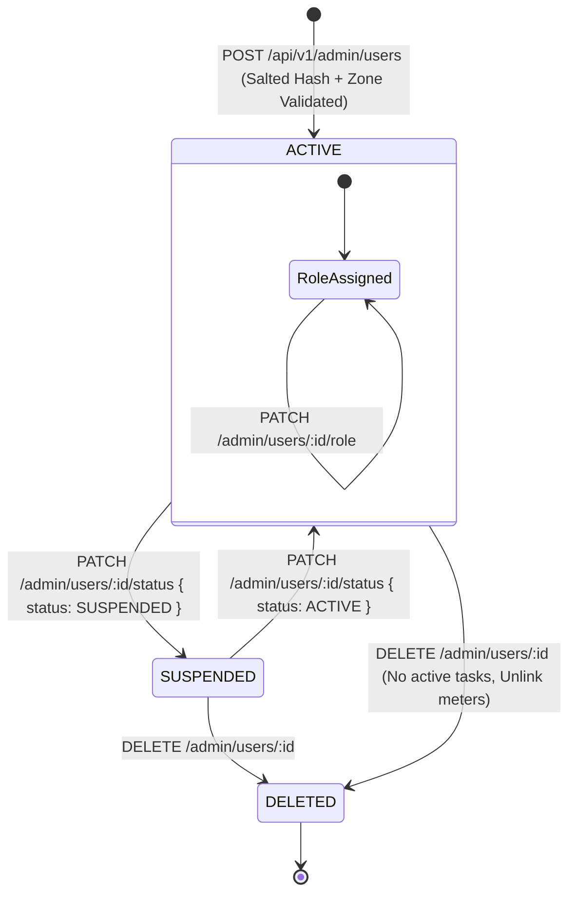

# Admin User Provisioning, Role Management, Status, and Scope Architecture (Phase 10)

## 1. Overview & Architectural Scope

Phase 10 standardizes and hardens the administrative user management lifecycle (Domain 9, Endpoints 52–58) in accordance with [`docs/api.md`](file:///g:/programming/CSE-3110/Zarin-loadshading/docs/api.md) and [`docs/phase-tracker.md`](file:///g:/programming/CSE-3110/Zarin-loadshading/docs/phase-tracker.md).

Administrative staff provisioning and lifecycle management are strictly gated to administrators (`UserRole.ADMIN`). This layer guarantees:
1. **Zero Credential Disclosure:** All administrative user responses strip bcrypt password hashes via `toSafeUser()`, remediating plaintext `passwordHash` disclosure in `PATCH /api/v1/admin/users/:id`.
2. **Strict Geographic Scoping:** Field Technicians and Zone Managers are verified against existing active zones (`store.zones`), rejecting phantom zone assignments (`404 ZONE_NOT_FOUND`) and unassigned Zone Managers (`400 ZONE_REQUIRED`).
3. **Administrative Safeguards:** Self-suspension (`400 SELF_SUSPENSION_FORBIDDEN`) and self-deletion (`400 SELF_DELETION_FORBIDDEN`) are proactively blocked to prevent lockout of root administrative accounts.
4. **Operational Continuity:** Deprovisioning active field technicians with pending or in-progress maintenance tasks is blocked (`400 ACTIVE_TASKS_EXIST`) until assignments are completed or reassigned.
5. **Relational Cleanup:** Soft-deleting Customer accounts cascades to soft-unlink their associated customer meter records (`unlinkedAt = now`).
6. **Immutable Audit Trail:** All administrative user state transitions (`PROVISION_USER`, `UPDATE_USER`, `UPDATE_USER_ROLE`, `UPDATE_USER_STATUS`, `SUSPEND_USER`, `REACTIVATE_USER`, `SOFT_DELETE_USER`) generate structured records in `store.auditLogs`.

---

## 2. Admin User Lifecycle State Diagram



---

## 3. Endpoint Specifications

### 1. `GET /api/v1/admin/users` (Endpoint 52)
- **Access:** Admin only (`requireRoles(UserRole.ADMIN)`).
- **Query Parameters:**
  - `role`: Filter by `UserRole` (`CUSTOMER`, `POWER_OPERATOR`, `TECHNICIAN`, `ZONE_MANAGER`, `ADMIN`).
  - `status`: Filter by `UserStatus` (`ACTIVE`, `SUSPENDED`).
  - `zoneId`: Filter by assigned zone identifier.
  - `page`: Page index (default: `1`).
  - `pageSize`: Page size (default: `20`).
- **Response Format:**
  - Standardized `PaginatedData<SafeUser & { zone: ZoneSummary | null }>` envelope.
  - Strips `passwordHash`.
  - Enriches user profile with `zone: { id, name, code }` when `assignedZoneId` is present.

### 2. `POST /api/v1/admin/users` (Endpoint 53)
- **Access:** Admin only.
- **Request Body:** Validated via `provisionUserSchema`.
  ```json
  {
    "name": "Field Technician Kamal",
    "email": "kamal.tech@grid.gov.bd",
    "password": "SecurePassword123!",
    "phone": "+8801700000099",
    "role": "TECHNICIAN",
    "assignedZoneId": "zn_mirpur"
  }
  ```
- **Validation Rules:**
  - `409 EMAIL_EXISTS`: If email is registered to another active account.
  - `404 ZONE_NOT_FOUND`: If `assignedZoneId` does not reference an active, non-deleted zone.
  - `400 ZONE_REQUIRED`: If `role === UserRole.ZONE_MANAGER` and no `assignedZoneId` is provided.
- **Outcome:** Generates bcrypt salt (`cost = 10`), hashes password, persists user, logs audit record (`PROVISION_USER`), and returns `201 Created` with `toSafeUser(user)`.

### 3. `GET /api/v1/admin/users/:id` (Endpoint 54)
- **Access:** Admin only.
- **Response Format:** `SafeUser & { zone: ZoneSummary | null }`.
- **Validation:** Returns `404 USER_NOT_FOUND` if target user does not exist or has `deletedAt !== null`.

### 4. `PATCH /api/v1/admin/users/:id` (Endpoint 55)
- **Access:** Admin only.
- **Request Body:** Validated via `updateUserAdminSchema` (`name`, `phone`, `role`, `status`, `assignedZoneId`).
- **Security Hardening:** Strictly returns `toSafeUser(user)`. Eliminates previous plaintext `passwordHash` leakage.
- **Validation:** Verifies `assignedZoneId` existence (`404 ZONE_NOT_FOUND`).

### 5. `PATCH /api/v1/admin/users/:id/role` (Endpoint 56)
- **Access:** Admin only.
- **Request Body:** Validated via `updateUserRoleSchema`:
  ```typescript
  export const updateUserRoleSchema = z.object({
    role: z.nativeEnum(UserRole),
    assignedZoneId: z.string().nullable().optional()
  });
  ```
- **Business Logic:**
  - Validates `assignedZoneId` exists if passed (`404 ZONE_NOT_FOUND`).
  - If target role is `ZONE_MANAGER`, ensures effective zone ID (`data.assignedZoneId ?? user.assignedZoneId`) is non-null (`400 ZONE_REQUIRED`).
  - Updates role and zone scope; logs audit record `UPDATE_USER_ROLE`.

### 6. `PATCH /api/v1/admin/users/:id/status` (Endpoint 57)
- **Access:** Admin only.
- **Request Body:** Validated via `updateUserStatusSchema`:
  ```typescript
  export const updateUserStatusSchema = z.object({
    status: z.nativeEnum(UserStatus)
  });
  ```
- **Safeguards:**
  - Prevents Admin self-suspension:
    ```typescript
    if (user.id === req.user.sub && data.status === UserStatus.SUSPENDED) {
      throw new BadRequestError('Cannot suspend your own administrator account', 'SELF_SUSPENSION_FORBIDDEN');
    }
    ```
  - Also supported via backward-compatible aliases: `POST /api/v1/admin/users/:id/suspend` and `POST /api/v1/admin/users/:id/reactivate`.

### 7. `DELETE /api/v1/admin/users/:id` (Endpoint 58)
- **Access:** Admin only.
- **Safeguards:**
  - Prevents Admin self-deletion:
    ```typescript
    if (user.id === req.user.sub) {
      throw new BadRequestError('Cannot delete your own administrator account', 'SELF_DELETION_FORBIDDEN');
    }
    ```
  - Blocks deprovisioning technicians with active dispatch tasks:
    ```typescript
    if (user.role === UserRole.TECHNICIAN) {
      const hasActiveTasks = Array.from(store.technicianAssignments.values()).some(
        (a) => a.technicianId === user.id && a.status !== 'COMPLETED'
      );
      if (hasActiveTasks) {
        throw new BadRequestError('Cannot delete technician with active assignments. Reassign first.', 'ACTIVE_TASKS_EXIST');
      }
    }
    ```
  - Soft-unlinks associated Customer meters (`cm.unlinkedAt = now`).
  - Soft-deletes user (`user.deletedAt = now`); logs audit record `SOFT_DELETE_USER`.

---

## 4. Administrative Security & Error Taxonomy

| Error Code | HTTP Status | Triggering Condition |
| :--- | :---: | :--- |
| `EMAIL_EXISTS` | 409 | Provisioning account with an email already taken by an active account |
| `ZONE_NOT_FOUND` | 404 | Specifying an assigned zone ID that does not exist in `store.zones` or is deleted |
| `ZONE_REQUIRED` | 400 | Assigning or promoting a user to `ZONE_MANAGER` without a valid zone assignment |
| `USER_NOT_FOUND` | 404 | Accessing, mutating, or deleting a user ID that does not exist or is soft-deleted |
| `SELF_SUSPENSION_FORBIDDEN` | 400 | Administrator attempting to suspend their own session account |
| `SELF_DELETION_FORBIDDEN` | 400 | Administrator attempting to deprovision/delete their own session account |
| `ACTIVE_TASKS_EXIST` | 400 | Attempting to delete a field technician with non-completed dispatch assignments |

---

## 5. Verification & Test Suite

The administrative user management endpoints are verified via automated tests in [`apps/api/src/test/runner.ts`](file:///g:/programming/CSE-3110/Zarin-loadshading/apps/api/src/test/runner.ts) (Test Suite 17):

- **Test 17a:** Paginated user discovery with `role` filter and stripped `passwordHash`.
- **Test 17b-1:** User provisioning with non-existent zone (`404 ZONE_NOT_FOUND`).
- **Test 17b-2:** User provisioning for `ZONE_MANAGER` without zone assignment (`400 ZONE_REQUIRED`).
- **Test 17b-3:** Successful staff provisioning with bcrypt hashing and safe envelope.
- **Test 17c:** Duplicate email provisioning rejection (`409 EMAIL_EXISTS`).
- **Test 17d:** User detail inspection enriched with zone metadata (`{ id, name, code }`).
- **Test 17e:** Profile mutation with verification of zero password hash disclosure.
- **Test 17f:** Role reassignment to `ZONE_MANAGER` with zone validation and scoping.
- **Test 17g:** Account status toggle with Administrator self-suspension block (`400 SELF_SUSPENSION_FORBIDDEN`).
- **Test 17h:** Account deprovisioning with Administrator self-deletion block (`400 SELF_DELETION_FORBIDDEN`), active task protection (`400 ACTIVE_TASKS_EXIST`), and soft-deletion lookup verification (`404 USER_NOT_FOUND`).

**Total Test Suite Results:** **94 PASSED, 0 FAILED**.
