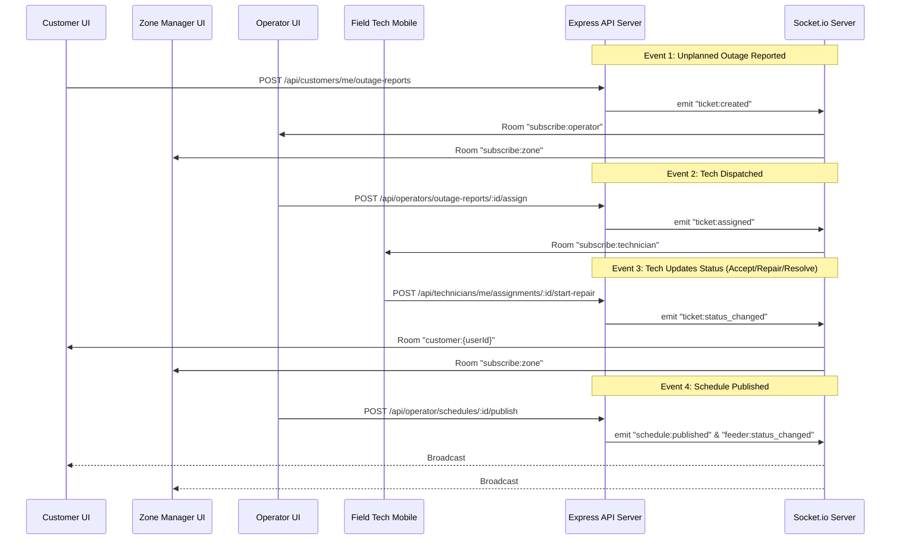
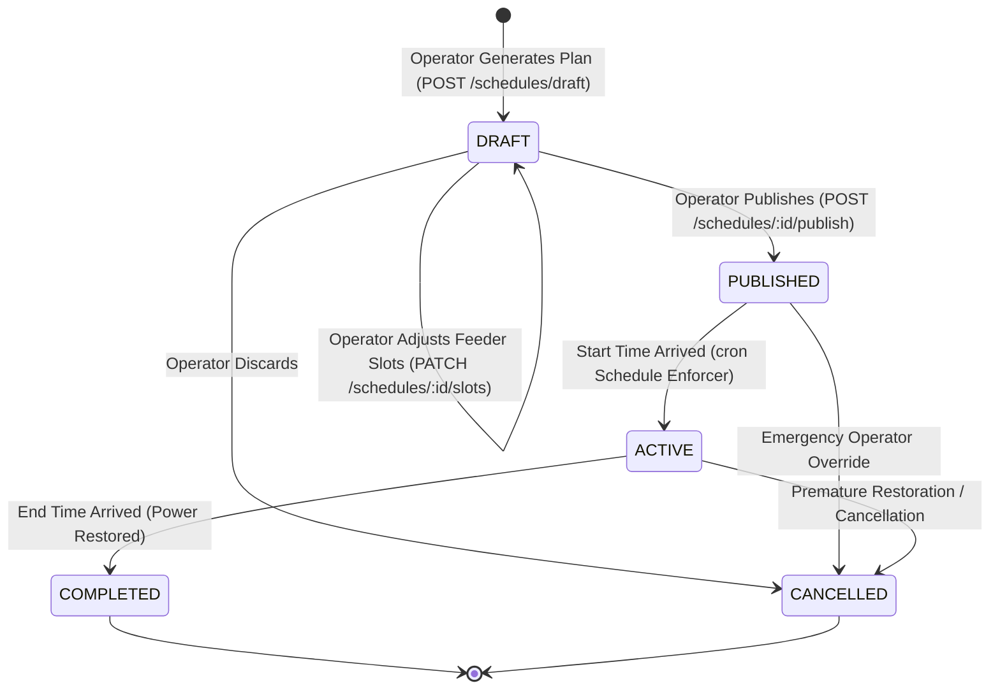
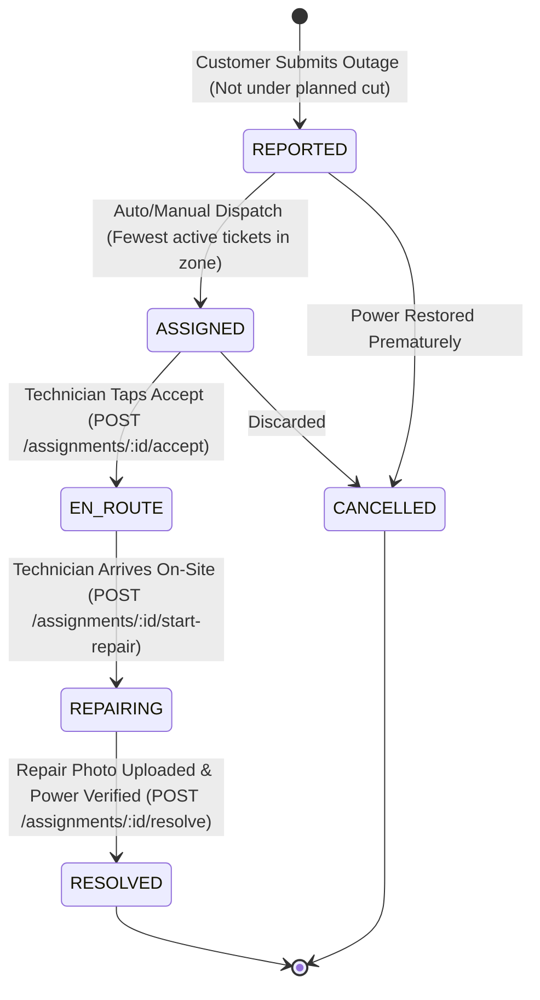

# System Architecture Document
## Load Shedding & Power Outage Management System

### 1. High-Level Architecture Overview

The system follows a modern, decoupled three-tier architecture with an Express.js API backend, a Next.js App Router frontend, a PostgreSQL database managed by Prisma ORM, and an Upstash Redis caching layer.

```mermaid
flowchart TD
    subgraph Client Tier
        Browser[Web Browser / Mobile View]
        CustomerUI[Customer Dashboard]
        OperatorUI[Control Room Dashboard]
        TechUI[Mobile Technician App]
        ManagerUI[Zone Manager Dashboard]
        AdminUI[Admin Dashboard]
    end

    subgraph Presentation & Routing
        NextJS[Next.js App Router (Frontend)]
    end

    subgraph Application Tier
        ExpressAPI[Express.js REST API Server]
        AuthModule[Auth & RBAC Middleware]
        SchedulerEngine[Load Shedding Scheduler Engine]
        ConflictResolver[Smart Conflict Resolution Service]
        SocketServer[Socket.io Real-Time Server]
        CronRunner[Node-Cron Background Jobs]
    end

    subgraph Data & Caching Tier
        Postgres[(PostgreSQL Neon DB)]
        PrismaORM[Prisma Client ORM]
        Redis[(Upstash Redis Cache)]
    end

    subgraph External Services
        Twilio[Twilio SMS API]
        FileStorage[Local / S3 Multipart Photo Storage]
    end

    Browser --> NextJS
    CustomerUI & OperatorUI & TechUI & ManagerUI & AdminUI --> NextJS
    NextJS -->|REST API / JSON| ExpressAPI
    Browser <-->|WebSocket wss://| SocketServer
    ExpressAPI --> AuthModule
    ExpressAPI --> SchedulerEngine
    ExpressAPI --> ConflictResolver
    ExpressAPI --> PrismaORM
    ExpressAPI --> Redis
    PrismaORM --> Postgres
    CronRunner --> ExpressAPI
    ExpressAPI --> Twilio
    ExpressAPI --> FileStorage
```

---

### 2. Monorepo Directory Organization

```
load-shedding-system/
├── apps/
│   ├── web/                     # Next.js 14+ App Router Frontend
│   │   ├── src/
│   │   │   ├── app/             # App Router pages and layout
│   │   │   │   ├── (auth)/      # Login, Register, Forgot Password, Verify Email
│   │   │   │   ├── (public)/    # Home, About, Public Schedules, Grid Status
│   │   │   │   ├── customer/    # Customer dashboard, meters, outage reports
│   │   │   │   ├── operator/    # Control room, schedule generator, dispatch
│   │   │   │   ├── technician/  # Mobile ticket queue, repair workflow
│   │   │   │   ├── manager/     # Zone grid table, failure analytics, upgrade requests
│   │   │   │   ├── admin/       # Infrastructure CRUD, staff users, audit logs
│   │   │   │   ├── layout.tsx
│   │   │   │   └── page.tsx
│   │   │   ├── components/      # UI components (Shadcn UI, tables, badges, dialogs)
│   │   │   ├── hooks/           # useAuth, useSocket, useGridStatus
│   │   │   ├── lib/             # API client, utils, socket connection
│   │   │   └── types/           # Frontend view models
│   │   ├── package.json
│   │   ├── tailwind.config.ts
│   │   └── tsconfig.json
│   │
│   └── api/                     # Node.js + Express.js Backend API
│       ├── src/
│       │   ├── config/          # Environment variables & constants
│       │   ├── middleware/      # Auth, RBAC, error handler, rate limit, upload
│       │   ├── modules/         # Domain modules (auth, users, grid, schedules, outages, tech, manager, admin)
│       │   │   ├── auth/
│       │   │   ├── users/
│       │   │   ├── grid/
│       │   │   ├── schedules/
│       │   │   ├── outages/
│       │   │   ├── technician/
│       │   │   ├── manager/
│       │   │   └── admin/
│       │   ├── services/        # Business logic services (scheduler, conflict resolver, notification, sms)
│       │   ├── sockets/         # Socket.io handlers, room subscriptions, emitters
│       │   ├── jobs/            # Node-cron background scheduled workers
│       │   ├── utils/           # Response formatter, logger, date helpers
│       │   ├── app.ts           # Express application setup
│       │   └── server.ts        # HTTP & WebSocket server entrypoint
│       ├── prisma/
│       │   ├── schema.prisma    # Complete relational schema
│       │   └── seed.ts          # Database seeder with sample grid & 5 roles
│       ├── package.json
│       └── tsconfig.json
│
├── packages/
│   └── shared/                  # Common TypeScript interfaces, enums & Zod schemas
│       ├── src/
│       │   ├── enums.ts
│       │   ├── types.ts
│       │   └── validators.ts
│       ├── package.json
│       └── tsconfig.json
│
├── docs/                        # Specifications, blueprints & documentation
│   ├── requirements-analysis.md
│   ├── architecture.md
│   ├── database-design.md
│   ├── api-inventory.md
│   └── implementation-roadmap.md
│
├── .env.example
├── package.json
└── README.md
```

---

### 3. Authentication & Session Architecture

To ensure strict security and prevent frontend role tampering:
1. **Stateless JWT with HTTP-Only Cookie or Bearer Token:**
   - On `POST /api/auth/login`, credentials are authenticated against `passwordHash` using Bcrypt.
   - If user status is `SUSPENDED`, login is rejected with `ACCOUNT_SUSPENDED`.
   - A signed JWT token is issued containing:
     ```json
     {
       "sub": "user_uuid",
       "role": "CUSTOMER | POWER_OPERATOR | TECHNICIAN | ZONE_MANAGER | ADMIN",
       "zoneId": "assigned_zone_uuid_or_null",
       "name": "User Name",
       "email": "user@example.com"
     }
     ```
   - Sent via an `HTTP-only`, `Secure`, `SameSite=Strict` cookie (`auth_token`) AND returned in response body for programmatic Bearer usage.
2. **Backend Authentication & Authorization Middleware:**
   - `authenticateUser`: Reads cookie or `Authorization: Bearer <token>`, verifies signature using `AUTH_SECRET`, and attaches `req.user`.
   - `requireRoles(...roles)`: Verifies `req.user.role` is within the authorized set.
   - `requireZoneAccess`: For Zone Managers, ensures they only access resources within their `assignedZoneId`. Admins bypass zone restrictions.
3. **Socket.io Authentication:**
   - Socket connection handshake extracts token from `socket.handshake.auth.token` or cookies.
   - Verified before allowing room subscriptions (`subscribe:zone`, `subscribe:operator`, `subscribe:technician`).

---

### 4. Real-Time Communication Architecture (Socket.io)



---

### 5. Caching Strategy (Upstash Redis)

To handle massive concurrent read traffic during peak load shedding:
- **Cached Key:** `schedules:published:{feederId}:{date}`
  - TTL: 24 hours (86,400 seconds).
  - Invalidation: Flushed whenever a schedule is published or cancelled.
- **Cached Key:** `grid:status:all` & `grid:status:{zoneId}`
  - TTL: 60 seconds.
  - Automatically invalidated on `feeder:status_changed` or ticket resolution.
- **Resilience:** If Redis is down or unreachable, the system falls back seamlessly to direct PostgreSQL queries with zero customer-facing downtime.


---

### 6. Operational State Machines & Planned Outage Definition

#### 6.1 Schedule Lifecycle State Machine



#### 6.2 Outage Ticket State Machine



#### 6.3 Mathematical Definition of an Active Planned Outage

A feeder or customer meter is considered under an **Active Planned Outage** if and only if all three conditions are satisfied:
1. **Schedule Status:** The parent schedule is in status `PUBLISHED` or `ACTIVE`.
2. **Time Interval:** The current server time $t$ satisfies:
   $$\text{startTime} \le t < \text{endTime}$$
   evaluated strictly within the operational timezone **`Asia/Dhaka`**.
3. **Target Feeder:** The feeder corresponding to the customer's electric meter is explicitly listed in `OutageScheduleItem`.

#### 6.4 The Smart Conflict Resolution Hard Rule

If a customer submits an outage report while their feeder satisfies the Active Planned Outage condition:
* An **`OutageReportEvent`** audit row is persisted (`isScheduledConflict: true`).
* **NO `OutageTicket` is created.**
* **NO technician is dispatched.**
* The API returns `200 OK` with an informative response:
  > *"Your area is currently under scheduled load shedding until HH:MM. This is an expected planned outage; no technician will be dispatched."*
