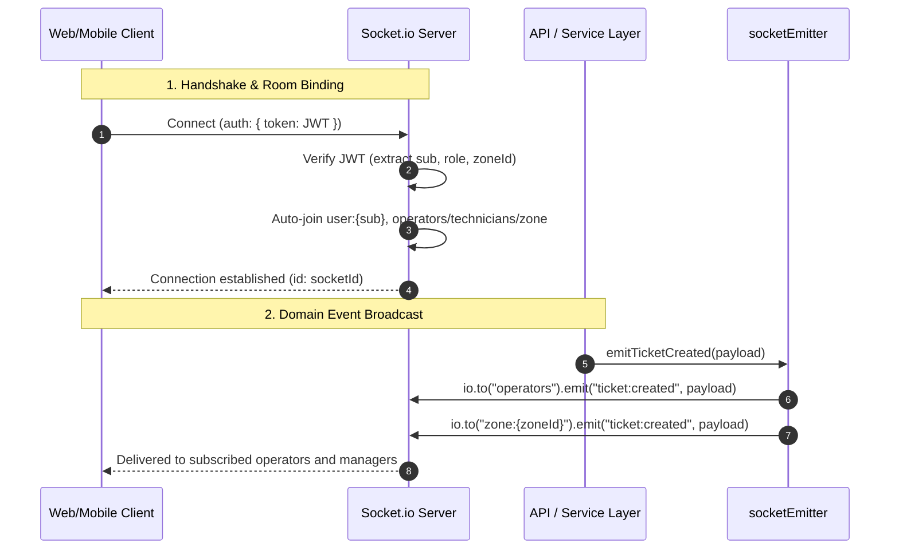

# Authenticated Socket.io Backbone and Domain Event Publication (Phase 23)

---

## 1. Executive Summary

Phase 23 delivers the real-time bidirectional communication backbone for the National Load Shedding & Power Outage Management System.

Built on **Socket.io 4.x**, it enables instantaneous event distribution from the central SCADA and outage dispatch servers to connected operator consoles, zone manager command centers, field technician handhelds, and customer mobile/web interfaces.

The implementation strictly satisfies:
1. **Decision D-13 (Socket.io Delivery Policy)**: WebSockets deliver ephemeral alerts and refresh hints; REST/database state remains authoritative. On reconnect or network drops, clients safely re-fetch authoritative REST state.
2. **Handshake JWT Authentication**: Tokens passed via `auth.token`, `Authorization: Bearer <token>` headers, or HTTP-only cookies are validated against `AUTH_SECRET`, extracting `sub`, `role`, and `assignedZoneId`.
3. **Role-Scoped Auto-Rooms**: Authenticated sockets automatically join their authorized private channels (`user:{id}`, `customer:{id}`, `operators`, `technicians`, `tech:{id}`, and `zone:{zoneId}`).
4. **Subscription Security Guards**: Subscription events (`subscribe:operator`, `subscribe:technician`) enforce strict RBAC checks, preventing unauthenticated guests or regular customers from intercepting operational grid channels.
5. **Real-time Domain Event Emitters**: Unified `socketEmitter` interface broadcasting feeder state transitions, ticket lifecycle events, published schedules, and customer in-app notifications.
6. **Administrative Telemetry**: `GET /api/v1/admin/socket/stats` providing real-time socket connection counts, authenticated proportions, and active room rosters.

---

## 2. Real-Time Architecture and Room Hierarchy

```
                                  ┌───────────────────────────┐
                                  │   Express + Socket.io     │
                                  │      Server (:4001)       │
                                  └─────────────┬─────────────┘
                                                │
                ┌───────────────────────────────┼───────────────────────────────┐
                ▼                               ▼                               ▼
       ┌─────────────────┐             ┌─────────────────┐             ┌─────────────────┐
       │   Global Feed   │             │   Zone Feeds    │             │   Targeted Room │
       │   (Public/All)  │             │ `zone:{zoneId}` │             │ `user:{userId}` │
       └────────┬────────┘             └────────┬────────┘             └────────┬────────┘
                │                               │                               │
                ▼                               ▼                               ▼
   feeder:status_changed              ticket:created                  notification:new
   schedule:published                 ticket:status_changed           ticket:status_changed
```

### 2.1 Room Scope Catalog

| Room Pattern | Access Control | Purpose |
| :--- | :--- | :--- |
| `user:{userId}` / `customer:{userId}` | Authenticated user (`sub === userId`) | Private customer alerts, outage resolution notifications, status changes. |
| `tech:{userId}` | Authenticated `TECHNICIAN` (`sub === userId`) | Direct ticket assignment dispatches, route updates, SLA warnings. |
| `operators` | `POWER_OPERATOR` or `ADMIN` role | Real-time ticket dispatch queue, feeder state changes, grid alarms. |
| `technicians` | `TECHNICIAN` or `ADMIN` role | Broadcast roster alerts, emergency dispatch announcements. |
| `zone:{zoneId}` | Zone Manager (assigned zone) or local public subscribers | District feeder outages, load shed status transitions, new tickets in zone. |
| `feeder:{feederId}` | Any subscriber monitoring a specific feeder | Feeder energization, planned outage, and restoration telemetry. |
| `ticket:{ticketId}` | Technician, customer, or operator assigned to ticket | Live repair status updates (`EN_ROUTE`, `REPAIRING`, `RESOLVED`). |

---

## 3. Domain Event Catalog



### 3.1 Event Payloads

1. **`feeder:status_changed` (`SocketEvent.FEEDER_STATUS_CHANGED`)**:
   ```json
   {
     "feederId": "feeder_dhaka_01",
     "status": "PLANNED_OUTAGE",
     "timestamp": "2026-10-31T17:35:00.000Z",
     "zoneId": "zone_dhaka_central"
   }
   ```
   *Destinations*: Global (`io.emit`), `operators`, `feeder:{feederId}`, `zone:{zoneId}`.

2. **`ticket:created` (`SocketEvent.TICKET_CREATED`)**:
   ```json
   {
     "ticketId": "tkt_1793468100_abc",
     "ticketNumber": "TKT-2026-0042",
     "feederId": "feeder_dhaka_01",
     "feederName": "Dhanmondi Road 27 Feeder",
     "zoneId": "zone_dhaka_central",
     "priority": "HIGH",
     "description": "Transformer spark observed on pole 14",
     "reportedAt": "2026-10-31T17:35:00.000Z"
   }
   ```
   *Destinations*: `operators`, `feeder:{feederId}`, `zone:{zoneId}`.

3. **`ticket:assigned` (`SocketEvent.TICKET_ASSIGNED`)**:
   ```json
   {
     "ticketId": "tkt_1793468100_abc",
     "technicianId": "usr_tech_01",
     "feederName": "Dhanmondi Road 27 Feeder",
     "address": "House 42, Road 27",
     "assignedAt": "2026-10-31T17:35:00.000Z"
   }
   ```
   *Destinations*: `tech:{technicianId}`, `technicians`, `ticket:{ticketId}`.

4. **`ticket:status_changed` (`SocketEvent.TICKET_STATUS_CHANGED`)**:
   ```json
   {
     "ticketId": "tkt_1793468100_abc",
     "customerId": "usr_cust_01",
     "zoneId": "zone_dhaka_central",
     "status": "REPAIRING",
     "updatedAt": "2026-10-31T17:35:00.000Z"
   }
   ```
   *Destinations*: `customer:{customerId}`, `user:{customerId}`, `operators`, `ticket:{ticketId}`, `zone:{zoneId}`.

5. **`schedule:published` (`SocketEvent.SCHEDULE_PUBLISHED`)**:
   ```json
   {
     "scheduleId": "sched_1793468100_xyz",
     "planningDate": "2026-11-01",
     "affectedFeedersCount": 14,
     "totalDeficitMwh": 48.5
   }
   ```
   *Destinations*: Global (`io.emit`), `operators`.

6. **`notification:new` (`SocketEvent.NOTIFICATION_NEW`)**:
   ```json
   {
     "id": "notif_1793468100_pqr",
     "userId": "usr_cust_01",
     "title": "Power Restored",
     "message": "Power has been restored to your feeder line.",
     "type": "POWER_RESTORED",
     "channel": "IN_APP",
     "createdAt": "2026-10-31T17:35:00.000Z"
   }
   ```
   *Destinations*: `user:{userId}`, `customer:{userId}`.

---

## 4. Administrative Socket Telemetry Endpoint

- **Route**: `GET /api/v1/admin/socket/stats` (Alias: `GET /api/admin/socket/stats`)
- **Authorization**: `Bearer <token>` (`ADMIN` role strictly enforced).

#### Response (`200 OK`):
```json
{
  "success": true,
  "statusCode": 200,
  "data": {
    "totalConnections": 18,
    "authenticatedConnections": 14,
    "guestConnections": 4,
    "activeRoomsCount": 6,
    "rooms": [
      "operators",
      "technicians",
      "zone:zone_dhaka_central",
      "user:usr_admin_01",
      "customer:usr_cust_01",
      "feeder:feeder_dhaka_01"
    ]
  },
  "timestamp": "2026-10-31T17:35:10.000Z"
}
```

---

## 5. Automated Verification Results (Test 30)

Automated test suite **Test 30 (30a–30h)** in `apps/api/src/test/runner.ts`:

| Test | Objective | Assertion |
| :--- | :--- | :--- |
| **30a** | Admin Socket Telemetry Endpoint | `GET /api/v1/admin/socket/stats` returns 200 with connection and room metrics. |
| **30b** | RBAC Guard on Socket Stats | Non-admin (Customer) receives `403 Forbidden`. |
| **30c** | Live Socket Handshake & Heartbeat | Client connects via WebSocket, exchanges `ping`/`pong` with server acknowledgement. |
| **30d** | Guest Subscription Guard | Unauthenticated guest attempting `subscribe:operator` rejected with `FORBIDDEN_OPERATOR_ACCESS`. |
| **30e** | Operator Handshake & Auto-room | Authenticated operator socket succeeds in subscribing to `operators` room. |
| **30f** | Feeder Status Changed Emitter | `socketEmitter.emitFeederStatusChanged` broadcasts to global and feeder rooms cleanly. |
| **30g** | Ticket Lifecycle Emitters | `emitTicketCreated`, `emitTicketAssigned`, `emitTicketStatusChanged` execute cleanly. |
| **30h** | In-App Notification Emitter | `emitNotificationNew` dispatches to private user room cleanly. |
