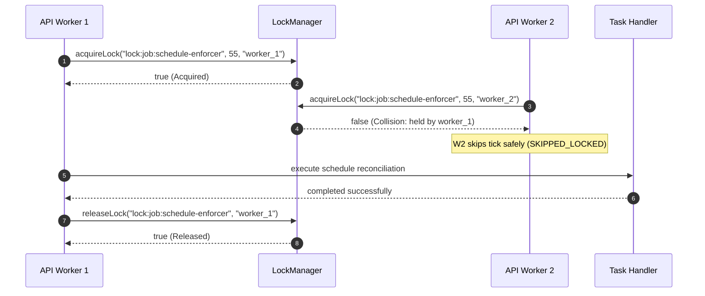

# Background Jobs, Locks, Restart Safety, and Simulation Guardrails (Phase 24)

---

## 1. Executive Summary

Phase 24 establishes the production-grade background automation infrastructure for the National Load Shedding & Power Outage Management System.

Background automations perform critical periodic operations without human intervention:
1. **Schedule Enforcer (`schedule-enforcer`)**: Scans published schedules at a 1-minute cadence (`*/1 * * * *`), automatically activating scheduled load shedding slots (`ONLINE` $\to$ `PLANNED_OUTAGE`) and restoring power when slots expire (`PLANNED_OUTAGE` $\to$ `ONLINE`).
2. **Notification Dispatcher (`notification-dispatcher`)**: Runs every 30 seconds (`*/30 * * * * *`), processing queued SMS alerts and delivering notifications with bounded exponential retry.
3. **Demo Simulator (`demo-simulator`)**: Runs every 5 minutes (`*/5 * * * *`), producing realistic load and generation fluctuations for operator control room demonstrations.
4. **Decision D-06 Distributed Locking**: Uses mutual exclusion leases (`DistributedLockManager`) to prevent concurrent task overlapping and race conditions across multi-instance API deployments.
5. **Decision D-14 Simulation Guardrails**: The demo simulator is strictly isolated and gated by `ENABLE_DEMO_SIMULATION=true`. In production, synthetic metrics never touch the system.
6. **Restart Safety & Reconciliation**: On service bootstrap, `reconcileScheduleFeederStatuses()` evaluates elapsed time to immediately correct any transitions that occurred while the process was restarting.
7. **Administrative Observability**: Exposes `GET /api/v1/admin/jobs/status` and `POST /api/v1/admin/jobs/:jobName/trigger` under strict `ADMIN` RBAC.

---

## 2. Background Automation Architecture

```
                               ┌────────────────────────────────────────────────────────┐
                               │             Node-Cron Runner (:4001)                  │
                               └──────────────────────────┬─────────────────────────────┘
                                                          │
          ┌───────────────────────────────────────────────┼───────────────────────────────────────────────┐
          │                                               │                                               │
          ▼                                               ▼                                               ▼
┌───────────────────────────────┐               ┌───────────────────────────────┐               ┌───────────────────────────────┐
│   Notification Dispatcher     │               │      Schedule Enforcer        │               │       Demo Simulator          │
│   Pattern: */30 * * * * *     │               │   Pattern: */1 * * * *        │               │   Pattern: */5 * * * *        │
│   Lock: lock:job:notification-│               │   Lock: lock:job:schedule-    │               │   Lock: lock:job:demo-        │
│         dispatcher (TTL 25s)  │               │         enforcer (TTL 55s)    │               │         simulator (TTL 280s)  │
└──────────────┬────────────────┘               └──────────────┬────────────────┘               └──────────────┬────────────────┘
               │                                               │                                               │
               ▼                                               ▼                                               ▼
┌───────────────────────────────┐               ┌───────────────────────────────┐               ┌───────────────────────────────┐
│   smsService.dispatchQueue()  │               │ 1. Feeder slot start/end check│               │ GATED: config.enableDemo-     │
│   • Retries (max 3 attempts)  │               │ 2. Mutate status (PLANNED)    │               │        Simulation === true    │
│   • Sets SENT or FAILED       │               │ 3. socketEmitter broadcast    │               │ • Injects grid load jitter    │
│                               │               │ 4. Invalidate Redis caches    │               │ • Keeps max 288 records (24h) │
└───────────────────────────────┘               └───────────────────────────────┘               └───────────────────────────────┘
```

---

## 3. Distributed Mutual Exclusion Locking (Decision D-06)

To prevent duplicate SMS dispatches or colliding schedule evaluations when running multiple API replicas behind a load balancer:

1. **Acquire Lease (`acquireLock(key, ttlSeconds, ownerId)`)**:
   - Evaluates active leases for `key`.
   - If an unexpired lease is held by another worker: acquisition fails (`false`).
   - If no lease exists or lease has expired: lease is granted to `ownerId` with `expiresAt = now + ttlSeconds`.
2. **Release Lease (`releaseLock(key, ownerId)`)**:
   - Only the worker holding the lease can release it. Mismatched releases are rejected with a warning.
3. **Execution Wrapper (`withLock(key, ttlSeconds, fn)`)**:
   - Wraps task execution with guaranteed lock release in a `finally` block.



---

## 4. Schedule Enforcer and Restart Safety

### 4.1 State Transition Rules

The Schedule Enforcer runs every minute (`*/1 * * * *`) and evaluates every published schedule:

$$\text{Current Time } t \in [\text{slot.startTime}, \text{slot.endTime}] \land \text{feeder.status} = \texttt{ONLINE} \implies \text{feeder.status} \leftarrow \texttt{PLANNED\_OUTAGE}$$

$$\text{Current Time } t > \text{slot.endTime} \land \text{feeder.status} = \texttt{PLANNED\_OUTAGE} \land \neg \exists \text{ active unexpected tickets} \implies \text{feeder.status} \leftarrow \texttt{ONLINE}$$

### 4.2 Fault Ticket Preservation
If an unexpected emergency outage ticket (e.g. blown transformer, fallen line) was logged on a feeder during its scheduled load shedding window, the feeder status is **NOT** restored to `ONLINE` when the scheduled window concludes. It remains in its fault state until field technicians complete repairs.

### 4.3 Startup Reconciliation Pass
When the API server starts up or recovers from a container restart, `startBackgroundJobs()` immediately invokes `reconcileScheduleFeederStatuses(new Date())`. Any slots that began or ended while the service was offline are brought into exact synchronization before accepting client traffic.

---

## 5. Demo Simulation Guardrail (Decision D-14)

```typescript
const simulationEnabled = Boolean(config.enableDemoSimulation);
if (!config.enableDemoSimulation) {
  logger.debug('[SIMULATOR] Demo simulation disabled by configuration. No metrics injected.');
  return;
}
```

- When `ENABLE_DEMO_SIMULATION=false` (default):
  The `demo-simulator` job returns immediately with status `SKIPPED_LOCKED`. No synthetic load, generation, or deficit points are written to `store.gridMetrics`.
- When `ENABLE_DEMO_SIMULATION=true`:
  Generates national power metrics within realistic bounds (12,000 MW base demand, 11,000 MW base capacity, randomized variance) and caps historical retention to 288 records (24 hours of 5-minute ticks).

---

## 6. Administrative Job Management REST Endpoints

### 6.1 Endpoint: Get Background Jobs Telemetry
- **Route**: `GET /api/v1/admin/jobs/status` (Aliases: `GET /api/admin/jobs/status`, `GET /api/v1/admin/jobs`)
- **Authorization**: `Bearer <token>` (`ADMIN` role strictly enforced).

#### Response (`200 OK`):
```json
{
  "success": true,
  "statusCode": 200,
  "data": [
    {
      "name": "schedule-enforcer",
      "schedule": "*/1 * * * *",
      "lockKey": "lock:job:schedule-enforcer",
      "enabled": true,
      "lastRunAt": "2026-10-31T17:35:11.233Z",
      "lastRunDurationMs": 14,
      "lastRunStatus": "SUCCESS",
      "lastErrorMessage": null,
      "totalRuns": 1,
      "isRunning": false
    },
    {
      "name": "notification-dispatcher",
      "schedule": "*/30 * * * * *",
      "lockKey": "lock:job:notification-dispatcher",
      "enabled": true,
      "lastRunAt": "2026-10-31T17:35:00.000Z",
      "lastRunDurationMs": 28,
      "lastRunStatus": "SUCCESS",
      "lastErrorMessage": null,
      "totalRuns": 4,
      "isRunning": false
    },
    {
      "name": "demo-simulator",
      "schedule": "*/5 * * * *",
      "lockKey": "lock:job:demo-simulator",
      "enabled": false,
      "lastRunAt": null,
      "lastRunDurationMs": null,
      "lastRunStatus": "IDLE",
      "lastErrorMessage": null,
      "totalRuns": 0,
      "isRunning": false
    }
  ]
}
```

### 6.2 Endpoint: Manually Trigger Background Job
- **Route**: `POST /api/v1/admin/jobs/:jobName/trigger` (Alias: `POST /api/admin/jobs/:jobName/trigger`)
- **Authorization**: `Bearer <token>` (`ADMIN` role strictly enforced).

#### Response (`200 OK`):
```json
{
  "success": true,
  "statusCode": 200,
  "data": {
    "jobName": "schedule-enforcer",
    "triggered": true,
    "executedAt": "2026-10-31T17:35:11.233Z",
    "status": "SUCCESS",
    "message": "Job executed successfully in 14ms",
    "durationMs": 14
  }
}
```

#### Error Handling:
- Non-existent job name returns `404 Not Found` with `JOB_NOT_FOUND`.
- Calling endpoint as non-admin returns `403 Forbidden`.

---

## 7. Automated Verification Results (Test 31)

Automated test suite **Test 31 (31a–31h)** in `apps/api/src/test/runner.ts`:

| Test | Objective | Assertion |
| :--- | :--- | :--- |
| **31a** | Mutual Exclusion Lock | Worker 1 acquires lock; Worker 2 concurrent acquisition fails with collision. |
| **31b** | Owner-Enforced Release | Only holding owner can release lock; becomes immediately re-acquirable. |
| **31c** | Slot Activation Transition | Feeder inside published slot transitions `ONLINE` $\to$ `PLANNED_OUTAGE`. |
| **31d** | Slot Completion Transition | Feeder restored to `ONLINE` upon slot expiration when no active tickets exist. |
| **31e** | Fault Ticket Preservation | Feeder with active unexpected outage ticket remains in outage; not restored to `ONLINE`. |
| **31f** | Restart Safety Pass | Startup reconciliation pass executes without errors and returns evaluation counts. |
| **31g** | Simulation Guardrail | Demo simulator blocked when `ENABLE_DEMO_SIMULATION=false`; zero synthetic metrics written. |
| **31h** | Admin Job Endpoints | `GET /jobs/status` returns registered automations; `POST /jobs/:name/trigger` executes on demand; 404 for invalid job. |
