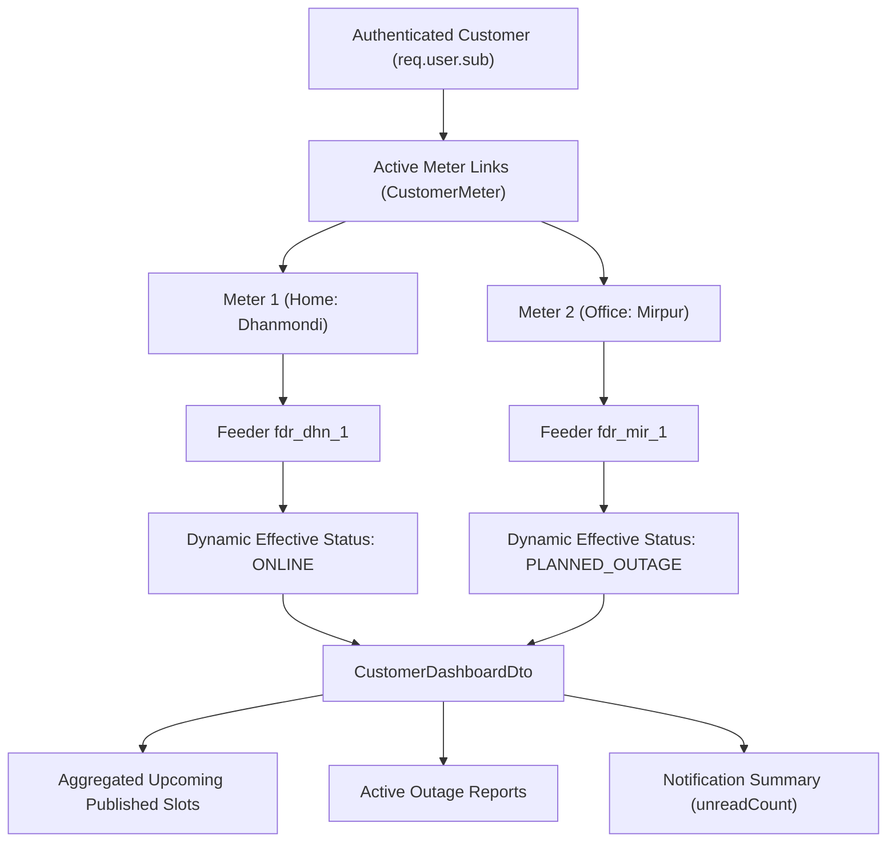
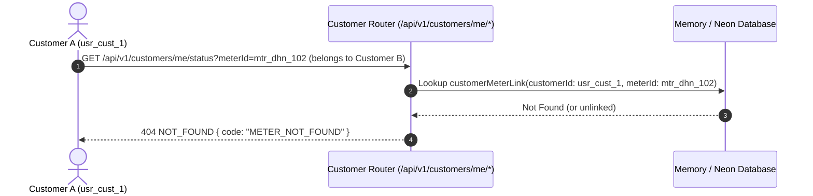

# Customer Read Journey, Multi-Meter Dashboard, and Cache-Aside Architecture

## 1. Executive Summary

Phase 15 implements the citizen customer read journey for the **National Load Shedding & Power Outage Management System**. It delivers real-time situational awareness to energy consumers across three high-throughput read surfaces:
1. **Aggregated Customer Dashboard** (`GET /api/v1/customers/me/dashboard`): A single pane of glass aggregating all active linked meters, real-time effective power status, upcoming published load shedding slots, active outage tickets, and unread notification tallies.
2. **Multi-Meter Live Status** (`GET /api/v1/customers/me/status`): Live telemetry query supporting both single-meter inspection (via `?meterId=...`) and multi-meter portfolio listings (when `meterId` is omitted).
3. **Upcoming Feeder Schedule** (`GET /api/v1/customers/me/schedule`): Cache-aside timeline of upcoming published load shedding slots affecting the customer's physical connection lines, with strict draft schedule isolation.

---

## 2. Multi-Meter Aggregation (No Primary Meter Assumption)

Citizens frequently own or manage multiple electric meters (e.g. primary residence, secondary residence, business office, or rental property). The customer read models support full multi-meter aggregation without assuming a single primary meter:



### Architectural Rules for Status & Dashboard:
- **When `meterId` is provided:** The system verifies that the requested meter is actively linked to the calling user's account. It returns a single `CustomerMeterStatusDto`.
- **When `meterId` is omitted:** The system queries all active linked meters for the customer and returns an array of `CustomerMeterStatusDto` objects. It **strictly does not assume a primary meter**.
- **Backward Compatibility:** For legacy web clients expecting a `primaryMeter` field on the dashboard, the payload retains `primaryMeter` (pointing to the primary or first active meter) alongside the canonical `meters` array.

---

## 3. Object-Level IDOR Protection

In multi-tenant utility systems, unauthorized meter enumeration poses a significant privacy and operational risk.



- If an authenticated customer provides a `meterId` that does not belong to them, the endpoint rejects the request with **`404 NOT_FOUND`** (`METER_NOT_FOUND`), preventing object-level access (IDOR) and preventing enumeration of active meters across customers.
- The same IDOR validation is enforced on `GET /api/v1/customers/me/schedule?meterId=...`.

---

## 4. Fault Precedence Rule (Dynamic Effective Status Engine)

The system does not return static database statuses (`feeder.status`). Instead, every read computes real-time operational status via `gridService.getEffectiveFeederStatus(feederId)`:

$$\text{Effective Status} = \begin{cases} 
\text{UNEXPECTED\_FAULT} & \text{if active, unresolved OutageTicket exists on feeder} \\
\text{PLANNED\_OUTAGE} & \text{if current timestamp } \in [\text{startTime}, \text{endTime}] \text{ of PUBLISHED slot} \\
\text{ONLINE} & \text{otherwise}
\end{cases}$$

> [!IMPORTANT]
> **Hardware Fault Precedence:** An unplanned hardware breakdown (`UNEXPECTED_FAULT`) strictly overrides scheduled load shedding (`PLANNED_OUTAGE`), because physical transformer or transmission damage prevents electrical flow regardless of schedule expiration.

---

## 5. Identity-Scoped Cache-Aside Architecture

Read endpoints utilize an identity-scoped cache key convention backed by Redis (with fallback to an in-memory TTL store):

| Read Surface | Cache Key Pattern | TTL | Invalidation Triggers |
| :--- | :--- | :--- | :--- |
| **Customer Dashboard** | `schedule:customer:{userId}:dashboard` | 60 seconds | Schedule publish, schedule cancel, new outage ticket, resolution |
| **Customer Schedule** | `schedule:customer:{userId}:upcoming:{meterId \|\| 'all'}` | 300 seconds | Schedule publish, schedule cancel, slot adjustment |
| **Public Feeder Status** | `grid:status:all`, `grid:status:{zoneId}` | 60 seconds | Status transition, schedule publish, outage resolution |
| **Public Schedule** | `schedules:public:{date}:{zoneId}:{feederId}` | 300 seconds | Schedule publish, schedule cancel |

### Cross-Identity Isolation:
- Customer A cannot read or prime Customer B's cache keys because every key is strictly prefixed with the authenticated customer's subject identity (`req.user.sub`).
- Responses explicitly indicate cache provenance via `{ ..., cached: true | false }`.

### Cache Invalidation Hooks:
Whenever an operator publishes or cancels a load shedding schedule in `scheduler.service.ts`:
1. `cacheService.del('grid:status:all')`
2. `cacheService.delPattern('schedules:public:*')`
3. `cacheService.invalidateCustomerSchedules()` $\to$ purges `schedule:customer:*`

Subsequent requests from any customer trigger a fresh database read and re-prime the cache with current state.

---

## 6. Strict Draft Schedule Immunity

Customers are only shown schedule slots where `schedule.status === ScheduleStatus.PUBLISHED`.
- Internal `DRAFT` schedules created by algorithmic runs or operator edits are completely shielded from customer APIs.
- Cancelled (`CANCELLED`) schedules are omitted from upcoming schedule projections.

---

## 7. Verification Evidence

The test suite in `apps/api/src/test/runner.ts` executes comprehensive automated assertions covering all Phase 15 guarantees:

```
[INFO] Testing Phase 15: Customer Read Journey, Multi-Meter Aggregation, IDOR, & Cache Invalidation
  ✅ PASS: Admin registers secondary physical meter MTR-MIR-105 on feeder fdr_mir_1
  ✅ PASS: Customer A links second meter MTR-MIR-105 with isPrimary=false
  ✅ PASS: GET /api/v1/customers/me/dashboard aggregates multi-meter status, upcoming schedules, and notifications (cache miss)
  ✅ PASS: GET /api/v1/customers/me/dashboard serves response from Redis cache on repeat (cached=true)
  ✅ PASS: GET /api/v1/customers/me/status without meterId returns status array for all linked meters
  ✅ PASS: GET /api/v1/customers/me/status?meterId={ownedId} returns single meter status
  ✅ PASS: IDOR Protection: GET /api/v1/customers/me/status?meterId={foreignId} strictly rejected with 404 METER_NOT_FOUND
  ✅ PASS: GET /api/v1/customers/me/schedule returns published slots across owned meters (cache miss)
  ✅ PASS: GET /api/v1/customers/me/schedule serves cached response on repeat query (cached=true)
  ✅ PASS: IDOR Protection: GET /api/v1/customers/me/schedule?meterId={foreignId} strictly rejected with 404 METER_NOT_FOUND
  ✅ PASS: Operator creates new draft schedule for cache invalidation test
  ✅ PASS: Operator publishes schedule, triggering cache invalidation hooks
  ✅ PASS: Cache Invalidation: Publishing schedule invalidates customer dashboard cache (cached=false on next fetch)

🏁 Test Summary: 174 PASSED, 0 FAILED
```
