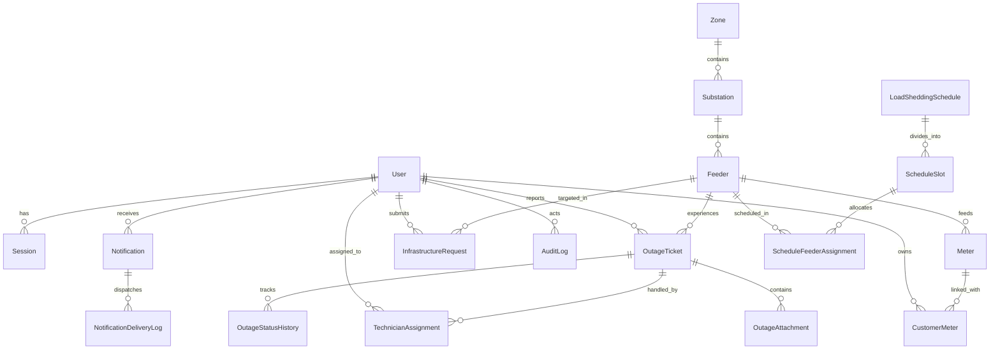

# Database Design Document
## Load Shedding & Power Outage Management System

### 1. Database Architecture & Technology Stack
- **Database Engine:** PostgreSQL (Neon Serverless compatible)
- **Object-Relational Mapping (ORM):** Prisma ORM
- **Identifier Strategy:** UUID v4 (strings) across all entities for distributed safety
- **Soft Deletion:** Core infrastructure (Zone, Substation, Feeder, Meter) and User entities include `deletedAt DateTime?`
- **Auditability:** Automatic `createdAt` and `updatedAt` timestamps on all records

---

### 2. Entity Relationship Diagram (ERD)



---

### 3. Enumerations

```prisma
enum UserRole {
  CUSTOMER
  POWER_OPERATOR
  TECHNICIAN
  ZONE_MANAGER
  ADMIN
}

enum UserStatus {
  ACTIVE
  SUSPENDED
  PENDING
}

enum FeederStatus {
  ONLINE
  PLANNED_OUTAGE
  UNEXPECTED_FAULT
}

enum ScheduleStatus {
  DRAFT
  PUBLISHED
  CANCELLED
}

enum OutageStatus {
  REPORTED
  ASSIGNED
  EN_ROUTE
  REPAIRING
  RESOLVED
  CANCELLED
}

enum AssignmentStatus {
  PENDING
  ACCEPTED
  IN_PROGRESS
  COMPLETED
  REASSIGNED
}

enum UpgradeRequestStatus {
  PENDING
  APPROVED
  REJECTED
}

enum NotificationType {
  PLANNED_SCHEDULE
  SCHEDULE_CANCELLED
  OUTAGE_REPORTED
  TECHNICIAN_DISPATCHED
  REPAIR_STARTED
  POWER_RESTORED
  UPGRADE_REQUEST_STATUS
  SYSTEM_ALERT
}

enum DeliveryStatus {
  QUEUED
  SENT
  FAILED
}
```

---

### 4. Relational Data Dictionary

#### 4.1. Identity & Access Management

| Table | Column | Type | Constraints / Description |
|---|---|---|---|
| **User** | `id` | String (UUID) | Primary Key |
| | `name` | String | User's full display name |
| | `email` | String | Unique, Indexed, required |
| | `phone` | String? | Customer phone for SMS notifications |
| | `passwordHash` | String | Bcrypt hash |
| | `role` | UserRole | Enum (`CUSTOMER`, `POWER_OPERATOR`, etc.) |
| | `status` | UserStatus | Enum (`ACTIVE`, `SUSPENDED`, `PENDING`), Default `ACTIVE` |
| | `assignedZoneId`| String? | FK to `Zone.id` for Zone Managers / Field Techs |
| | `emailVerified` | DateTime? | Timestamp when email verification occurred |
| | `createdAt` / `updatedAt` / `deletedAt` | DateTime | Standard audit timestamps |

| Table | Column | Type | Constraints / Description |
|---|---|---|---|
| **Session** | `id` | String (UUID) | Primary Key |
| | `userId` | String | FK to `User.id` (ON DELETE CASCADE) |
| | `token` | String | Unique session token |
| | `expiresAt` | DateTime | Expiration timestamp |
| | `userAgent` / `ipAddress` | String? | Client metadata |

| Table | Column | Type | Constraints / Description |
|---|---|---|---|
| **VerificationToken** | `id` | String (UUID) | Primary Key |
| | `email` | String | Target user email |
| | `token` | String | Unique cryptographically secure token |
| | `expiresAt` | DateTime | Expiry |
| | `usedAt` | DateTime? | When redeemed |

| Table | Column | Type | Constraints / Description |
|---|---|---|---|
| **PasswordResetToken** | `id` | String (UUID) | Primary Key |
| | `email` | String | Target user email |
| | `token` | String | Unique cryptographically secure reset token |
| | `expiresAt` | DateTime | Expiry |
| | `usedAt` | DateTime? | When redeemed |

---

#### 4.2. Grid Infrastructure Hierarchy

| Table | Column | Type | Constraints / Description |
|---|---|---|---|
| **Zone** | `id` | String (UUID) | Primary Key |
| | `name` | String | Unique zone name (e.g. "Dhanmondi") |
| | `code` | String | Unique zone code (e.g. "DHN") |
| | `description` | String? | Geographic description |
| | `createdAt` / `updatedAt` / `deletedAt` | DateTime | Timestamps |

| Table | Column | Type | Constraints / Description |
|---|---|---|---|
| **Substation** | `id` | String (UUID) | Primary Key |
| | `name` | String | Substation name (e.g. "Substation 4") |
| | `code` | String | Substation code |
| | `zoneId` | String | FK to `Zone.id` (ON DELETE RESTRICT) |
| | `capacityMW` | Float | Substation total transformer capacity (MW) |
| | `createdAt` / `updatedAt` / `deletedAt` | DateTime | Timestamps |

| Table | Column | Type | Constraints / Description |
|---|---|---|---|
| **Feeder** | `id` | String (UUID) | Primary Key |
| | `name` | String | Feeder name (e.g. "Feeder-12") |
| | `code` | String | Feeder unique code |
| | `substationId` | String | FK to `Substation.id` (ON DELETE RESTRICT) |
| | `capacityMW` | Float | Rated load capacity (MW) |
| | `isCritical` | Boolean | Default `false`. If `true`, NEVER shed |
| | `status` | FeederStatus | `ONLINE`, `PLANNED_OUTAGE`, `UNEXPECTED_FAULT` |
| | `createdAt` / `updatedAt` / `deletedAt` | DateTime | Timestamps |

| Table | Column | Type | Constraints / Description |
|---|---|---|---|
| **Meter** | `id` | String (UUID) | Primary Key |
| | `meterNumber` | String | Unique physical meter serial number |
| | `feederId` | String | FK to `Feeder.id` (ON DELETE RESTRICT) |
| | `address` | String | Physical service address |
| | `createdAt` / `updatedAt` / `deletedAt` | DateTime | Timestamps |

| Table | Column | Type | Constraints / Description |
|---|---|---|---|
| **CustomerMeter** | `id` | String (UUID) | Primary Key |
| | `customerId` | String | FK to `User.id` (ON DELETE CASCADE) |
| | `meterId` | String | FK to `Meter.id` (ON DELETE CASCADE) |
| | `isPrimary` | Boolean | Default `false` |
| | `nickname` | String? | E.g. "Home", "Factory" |
| | `linkedAt` | DateTime | Default `now()` |
| | `unlinkedAt` | DateTime? | Soft unlinking |

---

#### 4.3. Load Shedding & Scheduling

| Table | Column | Type | Constraints / Description |
|---|---|---|---|
| **LoadSheddingSchedule** | `id` | String (UUID) | Primary Key |
| | `planningDate` | String | YYYY-MM-DD target date |
| | `totalDeficitMW` | Float | Target deficit requested by grid |
| | `status` | ScheduleStatus | `DRAFT`, `PUBLISHED`, `CANCELLED` |
| | `createdById` | String | FK to `User.id` (Operator) |
| | `publishedAt` | DateTime? | When finalized & broadcasted |
| | `cancelledAt` | DateTime? | If revoked |
| | `notes` | String? | Operational remarks |
| | `createdAt` / `updatedAt` | DateTime | Timestamps |

| Table | Column | Type | Constraints / Description |
|---|---|---|---|
| **ScheduleSlot** | `id` | String (UUID) | Primary Key |
| | `scheduleId` | String | FK to `LoadSheddingSchedule.id` (ON DELETE CASCADE) |
| | `startTime` | DateTime | Exact slot start (ISO timestamp) |
| | `endTime` | DateTime | Exact slot end (ISO timestamp) |
| | `targetDeficitMW`| Float | Target deficit for this interval |
| | `actualDeficitMW`| Float | Sum of allocated feeder capacities |

| Table | Column | Type | Constraints / Description |
|---|---|---|---|
| **ScheduleFeederAssignment** | `id` | String (UUID) | Primary Key |
| | `slotId` | String | FK to `ScheduleSlot.id` (ON DELETE CASCADE) |
| | `feederId` | String | FK to `Feeder.id` |
| | `loadMW` | Float | Snapshot of feeder load |

---

#### 4.4. Outage Management & Field Repairs

| Table | Column | Type | Constraints / Description |
|---|---|---|---|
| **OutageTicket** | `id` | String (UUID) | Primary Key |
| | `ticketNumber` | String | Human-readable identifier (e.g. "TKT-2026-0001") |
| | `customerId` | String | FK to `User.id` |
| | `meterId` | String | FK to `Meter.id` |
| | `feederId` | String | FK to `Feeder.id` (Derived from meter) |
| | `description` | String | Customer complaint notes |
| | `landmark` | String? | Physical navigation reference |
| | `isPlanned` | Boolean | Default `false` |
| | `status` | OutageStatus | `REPORTED`, `ASSIGNED`, `EN_ROUTE`, `REPAIRING`, `RESOLVED`, `CANCELLED` |
| | `reportedAt` | DateTime | Default `now()` |
| | `resolvedAt` | DateTime? | Timestamp when completed |
| | `resolutionNotes`| String? | Technical explanation by technician |

| Table | Column | Type | Constraints / Description |
|---|---|---|---|
| **TechnicianAssignment** | `id` | String (UUID) | Primary Key |
| | `ticketId` | String | FK to `OutageTicket.id` (ON DELETE CASCADE) |
| | `technicianId` | String | FK to `User.id` (Role = `TECHNICIAN`) |
| | `assignedById` | String | FK to `User.id` (Operator / Manager) |
| | `status` | AssignmentStatus | `PENDING`, `ACCEPTED`, `IN_PROGRESS`, `COMPLETED`, `REASSIGNED` |
| | `assignedAt` | DateTime | Default `now()` |
| | `acceptedAt` | DateTime? | When accepted |
| | `startedAt` | DateTime? | When arrived on site |
| | `completedAt` | DateTime? | When resolved |

| Table | Column | Type | Constraints / Description |
|---|---|---|---|
| **OutageAttachment** | `id` | String (UUID) | Primary Key |
| | `ticketId` | String | FK to `OutageTicket.id` (ON DELETE CASCADE) |
| | `uploaderId` | String | FK to `User.id` |
| | `fileUrl` | String | File access URL |
| | `fileName` | String | Original uploaded filename |
| | `fileType` | String | MIME type (`image/jpeg`, etc.) |
| | `fileSize` | Int | Size in bytes (max 10MB) |
| | `createdAt` | DateTime | Default `now()` |

| Table | Column | Type | Constraints / Description |
|---|---|---|---|
| **OutageStatusHistory** | `id` | String (UUID) | Primary Key |
| | `ticketId` | String | FK to `OutageTicket.id` |
| | `previousStatus`| OutageStatus? | Previous state |
| | `newStatus` | OutageStatus | New state |
| | `changedById` | String? | Actor |
| | `notes` | String? | Optional context |
| | `createdAt` | DateTime | Default `now()` |

---

#### 4.5. Analytics, Upgrades & Notifications

| Table | Column | Type | Constraints / Description |
|---|---|---|---|
| **InfrastructureRequest** | `id` | String (UUID) | Primary Key |
| | `requesterId` | String | FK to `User.id` (Zone Manager) |
| | `feederId` | String | FK to `Feeder.id` |
| | `reason` | String | Rationale for capital investment |
| | `proposedAction` | String | Action (e.g. "Upgrade transformer to 400kVA") |
| | `supportingMetrics` | Json | Metrics snapshot (e.g. `{"faultsLast30Days": 9}`) |
| | `status` | UpgradeRequestStatus | `PENDING`, `APPROVED`, `REJECTED` |
| | `adminNotes` | String? | Justification by Administrator |
| | `reviewedById` | String? | FK to `User.id` (Admin) |
| | `reviewedAt` | DateTime? | Review timestamp |

| Table | Column | Type | Constraints / Description |
|---|---|---|---|
| **Notification** | `id` | String (UUID) | Primary Key |
| | `userId` | String | FK to `User.id` (Recipient) |
| | `title` | String | Notification subject |
| | `message` | String | Body text |
| | `type` | NotificationType | Enum |
| | `isRead` | Boolean | Default `false` |
| | `readAt` | DateTime? | Timestamp |
| | `metadata` | Json? | Additional identifiers (e.g. `{ ticketId: "..." }`) |
| | `createdAt` | DateTime | Default `now()` |

| Table | Column | Type | Constraints / Description |
|---|---|---|---|
| **NotificationDeliveryLog** | `id` | String (UUID) | Primary Key |
| | `notificationId`| String? | FK to `Notification.id` |
| | `recipientPhone`| String | Destination phone number |
| | `channel` | String | `SMS` / `IN_APP` |
| | `status` | DeliveryStatus | `QUEUED`, `SENT`, `FAILED` |
| | `providerResponse`| String? | Twilio SID or error message |
| | `attempts` | Int | Retry counter (max 3) |
| | `sentAt` | DateTime? | Dispatch timestamp |

| Table | Column | Type | Constraints / Description |
|---|---|---|---|
| **AuditLog** | `id` | String (UUID) | Primary Key |
| | `actorId` | String? | User who triggered the event |
| | `action` | String | Action identifier (e.g. `SCHEDULE_PUBLISHED`) |
| | `entity` | String | Entity name (`Feeder`, `User`, `Schedule`) |
| | `entityId` | String? | Target ID |
| | `details` | Json? | Contextual diff / payload |
| | `ipAddress` | String? | Client IP |
| | `createdAt` | DateTime | Timestamp |

| Table | Column | Type | Constraints / Description |
|---|---|---|---|
| **GridMetrics** | `id` | String (UUID) | Primary Key |
| | `totalDemandMW` | Float | Instantaneous national/regional demand |
| | `availableCapacityMW` | Float | Available generation |
| | `currentDeficitMW`| Float | Power deficit |
| | `activeOutagesCount`| Int | Active faults count |
| | `timestamp` | DateTime | Default `now()` |
