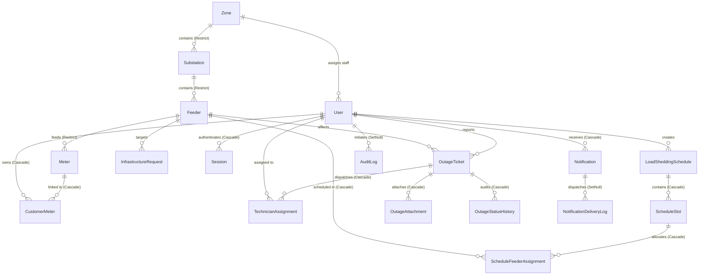

# Database Specification & Relational Grid Hierarchy
## Load Shedding & Power Outage Management System

This document formalizes the canonical database architecture, entity relationships, integrity constraints, deletion policies, indexing strategies, and data dictionaries for the backend persistence layer.

---

## 1. Architectural Overview & Persistence Strategy

* **RDBMS Engine:** PostgreSQL (Neon Serverless compatible, v15+).
* **Object-Relational Mapping (ORM):** Prisma ORM (`v5.22.0+`).
* **Identifier Strategy:** UUID v4 (`@default(uuid())`) across all primary keys to guarantee distributed safety, preventing enumeration attacks and collision risks across distributed workers and test fixtures.
* **Dual-Layer Consistency:**
  * **Relational Database Layer (`prisma.ts`):** Neon PostgreSQL enforcing ACID transactions, foreign key constraints (`Restrict` / `Cascade`), unique indexes, and referential integrity.
  * **In-Memory Mock Store Layer (`store.ts`):** Zero-dependency testing store replicating relational constraints and operations for fast local integration test execution (`src/test/runner.ts`).
* **Operational Timezone:** All scheduling, calendar resets, and slot math evaluate against `Asia/Dhaka` (`D-04`), while persistence timestamps (`createdAt`, `updatedAt`, `reportedAt`) are stored as standard UTC timestamps.

---

## 2. Entity Relationship Diagram (ERD)

---

## 3. Relational Grid Hierarchy & Integrity Invariants

The physical distribution network is modeled as a strictly enforced directed tree:

$$\text{Zone} \xrightarrow[\text{Restrict}]{1:N} \text{Substation} \xrightarrow[\text{Restrict}]{1:N} \text{Feeder} \xrightarrow[\text{Restrict}]{1:N} \text{Meter} \xleftarrow[\text{Cascade}]{M:N} \text{Customer User}$$

### 3.1 Strict Foreign Key Deletion Rules (`onDelete: Restrict`)
* **Upstream Grid Protection:** Deleting a `Zone` or `Substation` is blocked at the database engine level if active downstream children (substations, feeders, meters) exist.
* **Downstream Feeder Protection:** Deleting a `Feeder` is blocked if linked `Meter` records exist.
* **Orphan Prevention:** Grid infrastructure records cannot be accidentally orphaned by cascade deletion.

### 3.2 Decoupled Meter Ownership Model
* A `Meter` exists independently within a `Feeder` with its unique serial `meterNumber` and physical service `address`.
* `CustomerMeter` acts as a many-to-many junction entity allowing customers to bind one or more household meters (`isPrimary: true/false`, custom `nickname`).
* Utility staff can pre-register grid meters before customer accounts are provisioned (`D-07`).
* When a customer unlinks a meter, `unlinkedAt` is recorded, or the junction record is deleted without modifying the underlying physical `Meter`.

---

## 4. Deletion Policies & Soft-Delete Strategy

To satisfy strict regulatory audit trails and power grid reliability reporting, core entities must never undergo destructive hard deletes in production:

| Entity Category | Entities | Deletion Policy | Implementation Mechanism |
| :--- | :--- | :--- | :--- |
| **Grid Infrastructure** | `Zone`, `Substation`, `Feeder`, `Meter` | **Soft Delete + Restrict** | `deletedAt DateTime?` field; foreign keys use `onDelete: Restrict` |
| **Identity & Access** | `User` | **Soft Delete** | `deletedAt DateTime?`; active queries filter `deletedAt: null` |
| **User Sessions** | `Session` | **Cascade Hard Delete** | `onDelete: Cascade` when parent `User` is removed |
| **Customer Meter Links** | `CustomerMeter` | **Cascade / Soft Unlink** | `unlinkedAt DateTime?` or `onDelete: Cascade` |
| **Scheduling Records** | `LoadSheddingSchedule` | **Logical Status Cancel** | `status: CANCELLED` and `cancelledAt DateTime?`; child slots cascade on purge |
| **Field Outage Tickets** | `OutageTicket` | **Status State Machine** | Terminal state `RESOLVED` or `CANCELLED`; children cascade |
| **Audit & Delivery Logs** | `AuditLog`, `NotificationDeliveryLog` | **Set Null** | Actor or notification reference sets `onDelete: SetNull` to preserve log history |

---

## 5. Enumerations Dictionary

All system enumerations are strictly typed in Prisma and shared with the frontend:

### 5.1 `UserRole`
* `CUSTOMER`: Standard residential or commercial power consumer.
* `POWER_OPERATOR`: Control room engineer drafting and publishing load shedding schedules.
* `TECHNICIAN`: Field technician receiving dispatch assignments and submitting repair evidence.
* `ZONE_MANAGER`: Regional administrator reviewing failure rates and submitting infrastructure upgrade requests.
* `ADMIN`: Master administrator provisioning staff, managing zones, and auditing system events.

### 5.2 `UserStatus`
* `ACTIVE`: Normal operating privileges.
* `SUSPENDED`: Login blocked by administrator.
* `PENDING`: Awaiting verification or admin activation.

### 5.3 `FeederStatus`
* `ONLINE`: Normal energization state.
* `PLANNED_OUTAGE`: Temporarily de-energized under an active published load shedding schedule.
* `UNEXPECTED_FAULT`: De-energized due to physical fault, tripped breaker, or reported emergency.

### 5.4 `ScheduleStatus`
* `DRAFT`: Generated plan under review by Power Operator.
* `PUBLISHED`: Committed and active plan broadcasted to customers.
* `CANCELLED`: Revoked prior to or during execution.

### 5.5 `OutageStatus`
* `REPORTED`: Customer complaint registered.
* `ASSIGNED`: Field technician selected and dispatched.
* `EN_ROUTE`: Technician traveling to fault location.
* `REPAIRING`: Active maintenance in progress.
* `RESOLVED`: Repair verified and power restored (requires photo proof).
* `CANCELLED`: Invalid report or false alarm.

### 5.6 `AssignmentStatus`
* `PENDING`: Dispatched to technician, pending acknowledgment.
* `ACCEPTED`: Acknowledged by technician.
* `IN_PROGRESS`: Repair ongoing.
* `COMPLETED`: Finished and resolved.
* `REASSIGNED`: Transferred to alternate technician.

### 5.7 `UpgradeRequestStatus`
* `PENDING`: Awaiting executive review.
* `APPROVED`: Approved for capital expenditure.
* `REJECTED`: Declined by administration.

### 5.8 `NotificationType`
* `PLANNED_SCHEDULE`: Advance notice of scheduled power cut.
* `SCHEDULE_CANCELLED`: Scheduled outage cancelled or power restored early.
* `OUTAGE_REPORTED`: Confirmation of complaint intake.
* `TECHNICIAN_DISPATCHED`: Field crew en route notice.
* `REPAIR_STARTED`: Maintenance active notice.
* `POWER_RESTORED`: Restoration notice.
* `UPGRADE_REQUEST_STATUS`: Update on infrastructure proposal.
* `SYSTEM_ALERT`: Broadcast warning.

### 5.9 `DeliveryStatus`
* `QUEUED`: Staged for outbound dispatch.
* `SENT`: Successfully acknowledged by SMS gateway or Web Push.
* `FAILED`: Delivery attempt exhausted or gateway error.

---

## 6. Complete Data Models & Indexing Strategy

### 6.1 Identity & Authentication Models

#### `User`
* `id` (`String`, UUID v4, PK)
* `name` (`String`)
* `email` (`String`, Unique, Index)
* `phone` (`String?`)
* `passwordHash` (`String`)
* `role` (`UserRole`, Default `CUSTOMER`, Index)
* `status` (`UserStatus`, Default `ACTIVE`, Index)
* `assignedZoneId` (`String?`, FK to `Zone`)
* `emailVerified` (`DateTime?`)
* `createdAt` / `updatedAt` (`DateTime`)
* `deletedAt` (`DateTime?`)

#### `Session`
* `id` (`String`, UUID v4, PK)
* `userId` (`String`, FK to `User`, `onDelete: Cascade`, Index)
* `token` (`String`, Unique, Index)
* `expiresAt` (`DateTime`)
* `userAgent` (`String?`)
* `ipAddress` (`String?`)
* `createdAt` (`DateTime`)

#### `VerificationToken` & `PasswordResetToken`
* `id` (`String`, UUID v4, PK)
* `email` (`String`, Index)
* `token` (`String`, Unique, Index)
* `expiresAt` (`DateTime`)
* `usedAt` (`DateTime?`)
* `createdAt` (`DateTime`)

---

### 6.2 Grid Hierarchy Models

#### `Zone`
* `id` (`String`, UUID v4, PK)
* `name` (`String`, Unique)
* `code` (`String`, Unique)
* `description` (`String?`)
* `createdAt` / `updatedAt` (`DateTime`)
* `deletedAt` (`DateTime?`)

#### `Substation`
* `id` (`String`, UUID v4, PK)
* `name` (`String`)
* `code` (`String`, Unique)
* `zoneId` (`String`, FK to `Zone`, `onDelete: Restrict`, Index)
* `capacityMW` (`Float`)
* `createdAt` / `updatedAt` (`DateTime`)
* `deletedAt` (`DateTime?`)

#### `Feeder`
* `id` (`String`, UUID v4, PK)
* `name` (`String`)
* `code` (`String`, Unique)
* `substationId` (`String`, FK to `Substation`, `onDelete: Restrict`, Index)
* `capacityMW` (`Float`)
* `isCritical` (`Boolean`, Default `false`, Index)
* `status` (`FeederStatus`, Default `ONLINE`, Index)
* `createdAt` / `updatedAt` (`DateTime`)
* `deletedAt` (`DateTime?`)

#### `Meter`
* `id` (`String`, UUID v4, PK)
* `meterNumber` (`String`, Unique)
* `feederId` (`String`, FK to `Feeder`, `onDelete: Restrict`, Index)
* `address` (`String`)
* `createdAt` / `updatedAt` (`DateTime`)
* `deletedAt` (`DateTime?`)

#### `CustomerMeter`
* `id` (`String`, UUID v4, PK)
* `customerId` (`String`, FK to `User`, `onDelete: Cascade`, Index)
* `meterId` (`String`, FK to `Meter`, `onDelete: Cascade`, Index)
* `isPrimary` (`Boolean`, Default `false`)
* `nickname` (`String?`)
* `linkedAt` (`DateTime`, Default `now()`)
* `unlinkedAt` (`DateTime?`)
* **Constraints:** `@@unique([customerId, meterId])`

---

### 6.3 Scheduling & Allocation Models

#### `LoadSheddingSchedule`
* `id` (`String`, UUID v4, PK)
* `planningDate` (`String`, `YYYY-MM-DD`, Index)
* `totalDeficitMW` (`Float`)
* `status` (`ScheduleStatus`, Default `DRAFT`, Index)
* `createdById` (`String`, FK to `User`)
* `publishedAt` / `cancelledAt` (`DateTime?`)
* `notes` (`String?`)
* `createdAt` / `updatedAt` (`DateTime`)

#### `ScheduleSlot`
* `id` (`String`, UUID v4, PK)
* `scheduleId` (`String`, FK to `LoadSheddingSchedule`, `onDelete: Cascade`, Index)
* `startTime` (`DateTime`)
* `endTime` (`DateTime`)
* `targetDeficitMW` (`Float`)
* `actualDeficitMW` (`Float`)
* `createdAt` (`DateTime`)
* **Constraints:** `@@index([startTime, endTime])`

#### `ScheduleFeederAssignment`
* `id` (`String`, UUID v4, PK)
* `slotId` (`String`, FK to `ScheduleSlot`, `onDelete: Cascade`)
* `feederId` (`String`, FK to `Feeder`, `onDelete: Cascade`, Index)
* `loadMW` (`Float`)
* `createdAt` (`DateTime`)
* **Constraints:** `@@unique([slotId, feederId])`

---

### 6.4 Outage Ticket & Field Operations Models

#### `OutageTicket`
* `id` (`String`, UUID v4, PK)
* `ticketNumber` (`String`, Unique)
* `customerId` (`String`, FK to `User`, Index)
* `meterId` (`String`, FK to `Meter`)
* `feederId` (`String`, FK to `Feeder`, Index)
* `description` (`String`)
* `landmark` (`String?`)
* `isPlanned` (`Boolean`, Default `false`)
* `status` (`OutageStatus`, Default `REPORTED`, Index)
* `reportedAt` (`DateTime`, Default `now()`, Index)
* `resolvedAt` (`DateTime?`)
* `resolutionNotes` (`String?`)
* `createdAt` / `updatedAt` (`DateTime`)

#### `TechnicianAssignment`
* `id` (`String`, UUID v4, PK)
* `ticketId` (`String`, FK to `OutageTicket`, `onDelete: Cascade`, Index)
* `technicianId` (`String`, FK to `User`, Index)
* `assignedById` (`String`, FK to `User`)
* `status` (`AssignmentStatus`, Default `PENDING`, Index)
* `assignedAt` (`DateTime`, Default `now()`)
* `acceptedAt` / `startedAt` / `completedAt` (`DateTime?`)

#### `OutageAttachment`
* `id` (`String`, UUID v4, PK)
* `ticketId` (`String`, FK to `OutageTicket`, `onDelete: Cascade`, Index)
* `uploaderId` (`String`)
* `fileUrl` (`String`)
* `fileName` (`String`)
* `fileType` (`String`)
* `fileSize` (`Int`)
* `createdAt` (`DateTime`, Default `now()`)

#### `OutageStatusHistory`
* `id` (`String`, UUID v4, PK)
* `ticketId` (`String`, FK to `OutageTicket`, `onDelete: Cascade`, Index)
* `previousStatus` (`OutageStatus?`)
* `newStatus` (`OutageStatus`)
* `changedById` (`String?`)
* `notes` (`String?`)
* `createdAt` (`DateTime`, Default `now()`)

---

### 6.5 Analytics, Upgrades, Audit & Notifications

#### `InfrastructureRequest`
* `id` (`String`, UUID v4, PK)
* `requesterId` (`String`, FK to `User`)
* `feederId` (`String`, FK to `Feeder`, Index)
* `reason` (`String`)
* `proposedAction` (`String`)
* `supportingMetrics` (`Json`)
* `status` (`UpgradeRequestStatus`, Default `PENDING`, Index)
* `adminNotes` (`String?`)
* `reviewedById` (`String?`, FK to `User`)
* `reviewedAt` (`DateTime?`)
* `createdAt` / `updatedAt` (`DateTime`)

#### `Notification`
* `id` (`String`, UUID v4, PK)
* `userId` (`String`, FK to `User`, `onDelete: Cascade`, Index)
* `title` (`String`)
* `message` (`String`)
* `type` (`NotificationType`)
* `isRead` (`Boolean`, Default `false`, Index)
* `readAt` (`DateTime?`)
* `metadata` (`Json?`)
* `createdAt` (`DateTime`, Default `now()`)

#### `NotificationDeliveryLog`
* `id` (`String`, UUID v4, PK)
* `notificationId` (`String?`, FK to `Notification`, `onDelete: SetNull`)
* `recipientPhone` (`String`)
* `channel` (`String`)
* `status` (`DeliveryStatus`, Default `QUEUED`, Index)
* `providerResponse` (`String?`)
* `attempts` (`Int`, Default `0`)
* `sentAt` (`DateTime?`)
* `createdAt` (`DateTime`, Default `now()`)

#### `AuditLog`
* `id` (`String`, UUID v4, PK)
* `actorId` (`String?`, FK to `User`, `onDelete: SetNull`, Index)
* `action` (`String`, Index)
* `entity` (`String`)
* `entityId` (`String?`)
* `details` (`Json?`)
* `ipAddress` (`String?`)
* `createdAt` (`DateTime`, Default `now()`, Index)

#### `GridMetrics`
* `id` (`String`, UUID v4, PK)
* `totalDemandMW` (`Float`)
* `availableCapacityMW` (`Float`)
* `currentDeficitMW` (`Float`)
* `activeOutagesCount` (`Int`)
* `timestamp` (`DateTime`, Default `now()`, Index)
