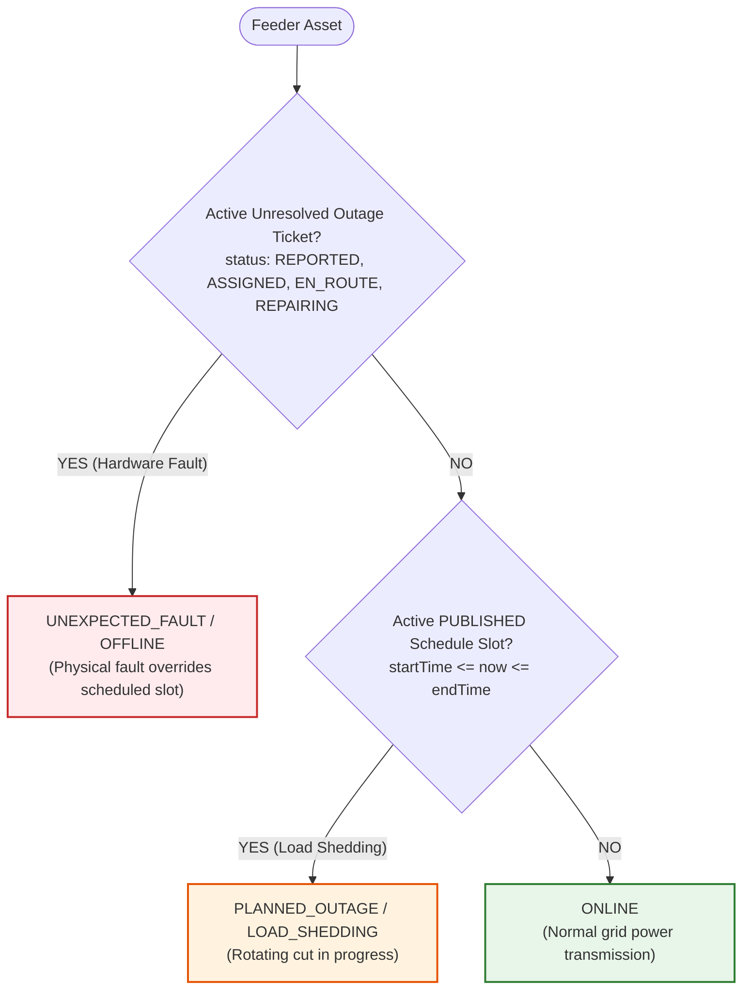
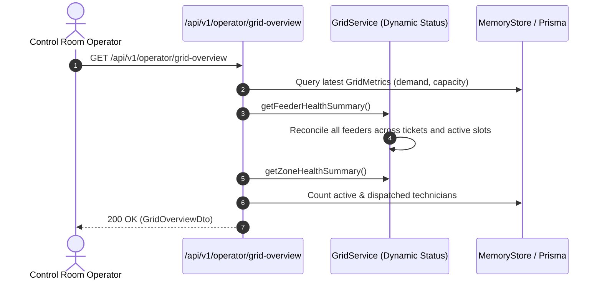

# Public Grid Discovery, Effective Feeder Status, and Operator Overview Architecture (Phase 12)

## 1. Overview & Architectural Scope

Phase 12 bridges static electrical grid assets with real-time operational telemetry and SCADA control room intelligence in accordance with [`docs/api.md`](file:///g:/programming/CSE-3110/Zarin-loadshading/docs/api.md) and [`docs/phase-tracker.md`](file:///g:/programming/CSE-3110/Zarin-loadshading/docs/phase-tracker.md).

$$\text{Topology} + \text{Schedules (Slots)} + \text{Incident Tickets (Outages)} \Longrightarrow \mathbf{Effective\ Feeder\ Status} \Longrightarrow \begin{cases} \text{Public Citizen Portal (18–20)} \\ \text{Operator Control Room (30, 37)} \end{cases}$$

This layer delivers:
1. **Deterministic Effective Feeder Status Engine (`grid.service.ts`):** Evaluates whether a feeder is currently `ONLINE`, undergoing `PLANNED_OUTAGE` (scheduled load shedding), or disabled by an `UNEXPECTED_FAULT` (emergency outage).
2. **Strict Fault Precedence Enforcement:** Physical hardware damage (unresolved `OutageTicket`) takes absolute priority over scheduled shedding. Even if a scheduled load-shed slot expires or is canceled, a damaged line remains de-energized until technician resolution with verified photo evidence.
3. **Public Grid Discovery (Domain 4, Endpoints 18–20):** High-throughput, unauthenticated citizen endpoints for viewing zones, feeders, and published load shedding schedules.
4. **Citizen Portal Caching:** `GET /api/v1/schedules/public` incorporates Redis/in-memory caching with a 60-second TTL, automatically invalidated on schedule publication or cancellation via `cacheService.delPattern('schedules:public:*')`.
5. **Power Operator Control Room (Domain 6, Endpoints 30 & 37):** Real-time SCADA dashboard overview of national demand, capacity, deficit, dynamic feeder health counts, technician assignment rosters, zone-by-zone operational breakdowns, and a unified live offline feeder tracker.

---

## 2. Effective Feeder Status Decision Engine

### State Transition & Precedence Hierarchy



### Precedence Rules

| Priority | Evaluated Condition | Resolved State | Operational Implication |
| :--- | :--- | :--- | :--- |
| **Priority 1 (Highest)** | Active `OutageTicket` (`status != RESOLVED && status != CANCELLED`) | `UNEXPECTED_FAULT` | Hardware failure (e.g. transformer blowout, tree on line). Overrides all schedule slots; requires physical dispatch and photo proof. |
| **Priority 2** | `PUBLISHED` schedule slot covers current timestamp ($t_{\text{start}} \le \text{now} \le t_{\text{end}}$) | `PLANNED_OUTAGE` | Rotating planned cut. Feeder energizes automatically once the slot window elapses unless a Priority 1 fault occurred. |
| **Priority 3 (Baseline)** | Neither condition above matches | `ONLINE` | Normal electrical flow within nominal operating voltage and capacity. |

---

## 3. Public Grid Discovery Endpoints (Domain 4)

### 1. `GET /api/v1/zones` (Endpoint 18)
- **Access:** Public (Unauthenticated).
- **Query Parameters:** `search` (case-insensitive name/code match), `page`, `pageSize`.
- **Enriched Relational Aggregations:**
  - `substationsCount`: Count of active substations in the zone.
  - `feedersCount`: Total count of active feeders operating across all substations in the zone.
  - `totalCapacityMW`: Aggregate nameplate transmission capacity of all zone feeders.
  - `activeOutagesCount`: Real-time count of zone feeders currently offline (`PLANNED_OUTAGE` or `UNEXPECTED_FAULT`).
- **Response Format:** Returns raw array for legacy callers, or `PaginatedData<ZonePublicSummaryDto>` when pagination parameters are provided.

### 2. `GET /api/v1/feeders` (Endpoint 19)
- **Access:** Public (Unauthenticated).
- **Query Parameters:** `zoneId`, `substationId`, `status` (`ONLINE`, `PLANNED_OUTAGE`, `UNEXPECTED_FAULT`), `isCritical` (`true`/`false`), `search`, `page`, `pageSize`.
- **Enriched Telemetry:**
  - `effectiveStatus`: Dynamically computed in real-time.
  - `connectedMetersCount`: Count of customer meters physically connected to this feeder.
  - `substationName` & `zoneName`: Human-readable parent hierarchy tags.
  - `activeOutage`: Summary of active incident if feeder is offline (`type`, `startTime`, `estimatedRestoration`, `ticketNumber`).

### 3. `GET /api/v1/schedules/public` (Endpoint 20)
- **Access:** Public (Unauthenticated).
- **Query Parameters:** `date` (YYYY-MM-DD, defaults to current date), `zoneId`, `feederId`.
- **Citizen Safety & Privacy Guard:** Exposes exclusively `PUBLISHED` schedules. Strips all operator IDs, staff notes, and draft plans.
- **Caching Strategy:** Results cached in Redis / memory (`schedules:public:<date>:<zoneId>:<feederId>`) with a 60-second TTL. Automatically purged on schedule publish (`POST /operator/schedules/:id/publish`) or cancellation (`POST /operator/schedules/:id/cancel`).

---

## 4. Power Operator Control Room Intelligence (Domain 6)



### 1. `GET /api/v1/operator/grid-overview` (Endpoint 30)
- **Access:** Operator, Admin, Zone Manager (`requireRoles(POWER_OPERATOR, ADMIN, ZONE_MANAGER)`).
- **Aliases:** Supported via canonical `/api/v1/operator/grid-overview` and legacy `/api/operator/overview`.
- **Payload Schema:**
  - `metrics`: Total demand (MW), available capacity (MW), dynamic deficit ($\max(0, \text{demand} - \text{capacity})$).
  - `feederCounts`: `{ total, online, plannedOutage, unexpectedFault, criticalExempt }`.
  - `activeOutages`: `{ plannedCount, unplannedCount, totalCount }`.
  - `technicians`: `{ total, active, dispatched }`.
  - `zoneBreakdown`: Array of per-zone operational health (`totalFeeders`, `onlineCount`, `outageCount`, `totalCapacityMW`).

### 2. `GET /api/v1/operator/outages/active` (Endpoint 37)
- **Access:** Operator, Admin, Zone Manager.
- **Query Parameters:** `zoneId`, `outageType` (`PLANNED` | `UNPLANNED`), `page`, `pageSize`.
- **Unified Offline Feeder Roster:** Merges unexpected fault tickets and scheduled load shedding slots into a unified operational feed.
  - Enriched with feeder identity, capacity, parent substation and zone.
  - Unplanned outages include ticket number, problem description, and assigned field technician contact.
  - Planned outages include scheduled start/end windows and target deficit allocation.
  - Both types include `impactedMetersCount` for quick customer impact assessment.

---

## 5. Automated Verification Results

All capabilities are verified by automated end-to-end tests in [`apps/api/src/test/runner.ts`](file:///g:/programming/CSE-3110/Zarin-loadshading/apps/api/src/test/runner.ts) (Test 19a–19f):

- **Test 19a:** Public Zones Discovery (relational counts, search filtering, pagination envelope).
- **Test 19b:** Public Feeders Discovery (effective status, hospital critical filter, zone scoping).
- **Test 19c:** Dynamic Load Shedding State Transition (active schedule slot sets `effectiveStatus` to `PLANNED_OUTAGE`).
- **Test 19d:** Fault Precedence Rule (unresolved outage ticket strictly overrides `PLANNED_OUTAGE` to `UNEXPECTED_FAULT`).
- **Test 19e:** Public Schedules Portal (Endpoint 20 query, assigned feeder metadata, Redis cache hit).
- **Test 19f:** Operator Grid Overview & Active Outages (RBAC 403 enforcement, SCADA telemetry, unified offline list, impacted meters).

**Test Execution Outcome:**
```text
🏁 Test Summary: 135 PASSED, 0 FAILED
```
