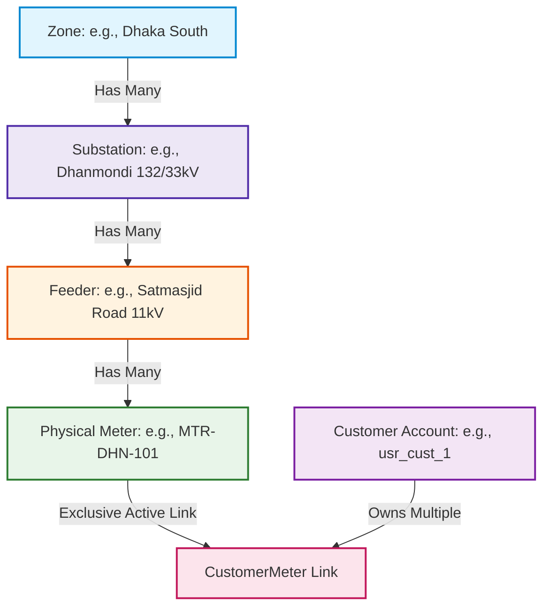
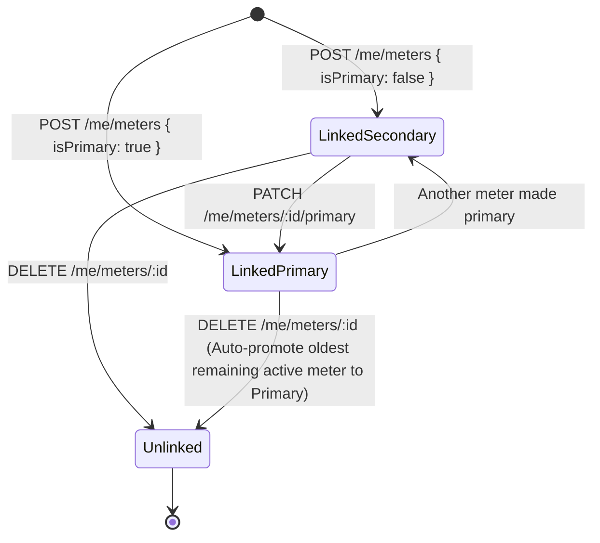

# Admin Grid Topology and Customer Meter Binding Architecture (Phase 11)

## 1. Overview & Architectural Scope

Phase 11 standardizes, completes, and hardens the administrative grid hierarchy management (Domain 9, Endpoints 59–73, 78–79) and customer-facing multi-meter lifecycle and status/schedule inspection (Domain 5, Endpoints 21–25) in accordance with [`docs/api.md`](file:///g:/programming/CSE-3110/Zarin-loadshading/docs/api.md) and [`docs/phase-tracker.md`](file:///g:/programming/CSE-3110/Zarin-loadshading/docs/phase-tracker.md).

The electrical grid is represented as a strict, physical four-tier relational hierarchy:
$$\text{Zone} \longrightarrow \text{Substation} \longrightarrow \text{Feeder} \longrightarrow \text{Meter} \longleftrightarrow \text{CustomerAccount}$$

This phase delivers:
1. **Full Grid Hierarchy CRUD:** Dedicated create, read, update, and delete endpoints for Zones, Substations, Feeders, and Meters.
2. **Referential Integrity & Cascade Deletion Guards:** Deleting higher-tier nodes when subordinate assets remain active is strictly forbidden, safeguarding against orphaned child entities.
3. **Unique Business Code Enforcement:** Unique code conflicts across all hierarchy levels are validated with distinct domain error codes (`ZONE_CODE_EXISTS`, `SUBSTATION_CODE_EXISTS`, `FEEDER_CODE_EXISTS`, `METER_NUMBER_EXISTS`).
4. **Physical Meter Cross-Account Exclusivity:** Physical meters cannot be linked simultaneously to multiple customer accounts. Any attempt to link an already-bound meter returns `409 METER_ALREADY_LINKED`.
5. **Primary Meter Lifecycle & Auto-Promotion:** Customers designate a single primary meter for billing and alerts. When the current primary meter is unlinked, the oldest remaining active meter is automatically promoted to primary.
6. **Per-Meter Live Status & Schedules (Endpoints 24 & 25):** Real-time feeder state, active outages, scheduled shedding slots, and strict IDOR protection preventing cross-customer meter telemetry leaks.

---

## 2. Grid Hierarchy & Referential Cascade Guards



### Cascade Deletion Safety Rules

| Level | Delete Endpoint | Blocker Condition | Rejection Code & HTTP Status |
| :--- | :--- | :--- | :--- |
| **Zone** | `DELETE /api/v1/admin/zones/:id` | Active substations exist in zone | `400 ACTIVE_SUBSTATIONS_EXIST` |
| **Substation** | `DELETE /api/v1/admin/substations/:id` | Active feeders exist in substation | `400 ACTIVE_FEEDERS_EXIST` |
| **Feeder** | `DELETE /api/v1/admin/feeders/:id` | Active meters exist on feeder | `400 ACTIVE_METERS_EXIST` |
| **Meter** | `DELETE /api/v1/admin/meters/:id` | Meter is actively linked to a customer | `400 METER_LINKED_TO_CUSTOMER` |

---

## 3. Customer Meter Binding & Exclusivity Lifecycle

### Physical Meter Exclusivity Protocol
When a customer attempts to link a meter (`POST /api/v1/customers/me/meters`):
1. **Verification of Physical Meter:** Checks `store.meters` for `meterNumber`. If not found, returns `404 METER_NOT_FOUND`.
2. **Cross-Customer Exclusivity Check:** Queries all active links (`!unlinkedAt`). If any active link exists across *any* customer account, returns `409 METER_ALREADY_LINKED`.
3. **Primary Selection:** If `isPrimary: true` was requested (or if this is the customer's very first meter link), any previous primary meter for that customer is cleared (`isPrimary = false`), and the newly linked meter is marked as primary.

### Primary Switching & Auto-Promotion


When an active primary meter is unlinked:
```typescript
const wasPrimary = link.isPrimary;
link.unlinkedAt = new Date().toISOString();
link.isPrimary = false;

if (wasPrimary) {
  const remaining = Array.from(store.customerMeters.values())
    .filter((cm) => cm.customerId === req.user.sub && !cm.unlinkedAt)
    .sort((a, b) => new Date(a.linkedAt).getTime() - new Date(b.linkedAt).getTime());

  if (remaining.length > 0) {
    remaining[0].isPrimary = true;
  }
}
```

---

## 4. Per-Meter Status & Upcoming Schedules

### Live Meter Status Calculation (`GET /api/v1/customers/me/meters/:id/status`)
Endpoint 24 resolves real-time telemetry for an individual meter:
- Resolves customer link ownership; returns `404 LINK_NOT_FOUND` if the meter belongs to another customer or is unlinked (IDOR prevention).
- Fetches physical meter and parent feeder metadata.
- Determines effective status:
  - If parent feeder has an active, unresolved outage ticket (`ASSIGNED`, `EN_ROUTE`, `REPAIRING`), status is `OFFLINE` with active outage details (`ticketNumber`, `cause`, `estimatedRestoration`).
  - Else if parent feeder is undergoing scheduled load shedding at the current timestamp, status is `LOAD_SHEDDING` with schedule details (`scheduleId`, `startTime`, `endTime`).
  - Otherwise, status is `ONLINE`.
- Returns enriched DTO:
  ```json
  {
    "meterId": "mtr_dhn_101",
    "meterNumber": "MTR-DHN-101",
    "nickname": "Dhanmondi Residence",
    "status": "ONLINE",
    "isPrimary": true,
    "feederId": "fdr_dhn_1",
    "feederName": "Satmasjid Road Feeder",
    "substationName": "Dhanmondi 132/33kV Substation",
    "zoneName": "Dhaka South",
    "currentLoadMw": 12.4,
    "capacityMw": 25.0,
    "voltageKv": 11.0,
    "updatedAt": "2026-10-30T00:00:00.000Z"
  }
  ```

### Meter Schedules (`GET /api/v1/customers/me/meters/:id/schedules`)
Endpoint 25 retrieves all published schedules for the physical meter's feeder line:
- Enforces customer link ownership (`404 LINK_NOT_FOUND`).
- Retrieves all `PUBLISHED` schedule slots where `feederId === meter.feederId`.
- Sorts by scheduled start time ascending.

---

## 5. Admin Grid Topology Endpoints Specification

### Zone Management (Endpoints 59–62)
- `GET /api/v1/admin/zones` — Paginated zone directory with `substationsCount`. Supports `status`, `search`, `page`, `pageSize`.
- `POST /api/v1/admin/zones` — Create zone (`name`, `code`, `boundaryJson`). Enforces unique `code` (`409 ZONE_CODE_EXISTS`).
- `PATCH /api/v1/admin/zones/:id` — Update zone name or boundary. Enforces unique code if altered.
- `DELETE /api/v1/admin/zones/:id` — Soft-deletes zone. Guarded by `400 ACTIVE_SUBSTATIONS_EXIST`.

### Substation Management (Endpoints 63–66)
- `GET /api/v1/admin/substations` — Paginated substation list with `zoneId`, `status`, `page`, `pageSize` filters. Enriches with parent zone name.
- `POST /api/v1/admin/substations` — Create substation. Validates parent `zoneId` (`404 ZONE_NOT_FOUND`) and unique `code` (`409 SUBSTATION_CODE_EXISTS`).
- `PATCH /api/v1/admin/substations/:id` — Update substation attributes. Validates new `zoneId` if supplied.
- `DELETE /api/v1/admin/substations/:id` — Soft-deletes substation. Guarded by `400 ACTIVE_FEEDERS_EXIST`.

### Feeder Management (Endpoints 67–70)
- `GET /api/v1/admin/feeders` — Paginated feeder list with `substationId`, `zoneId`, `isCritical`, `status`, `page`, `pageSize` filters.
- `POST /api/v1/admin/feeders` — Create feeder. Validates `substationId` (`404 SUBSTATION_NOT_FOUND`) and unique `code` (`409 FEEDER_CODE_EXISTS`).
- `PATCH /api/v1/admin/feeders/:id` — Update feeder capacity, critical status, or substation mapping.
- `DELETE /api/v1/admin/feeders/:id` — Soft-deletes feeder. Guarded by `400 ACTIVE_METERS_EXIST`.

### Meter Management (Endpoints 71–73, 78–79)
- `GET /api/v1/admin/meters` — Paginated meter directory with `feederId`, `status`, `page`, `pageSize` filters.
- `POST /api/v1/admin/meters` — Provision new physical meter. Validates `feederId` (`404 FEEDER_NOT_FOUND`) and unique `meterNumber` (`409 METER_NUMBER_EXISTS`).
- `GET /api/v1/admin/meters/:id` — Detailed physical meter inspection with feeder, substation, and active customer link metadata.
- `PATCH /api/v1/admin/meters/:id` — Update meter address, coordinates, or feeder assignment (`updateMeterSchema`).
- `DELETE /api/v1/admin/meters/:id` — Soft-deletes meter. Guarded by `400 METER_LINKED_TO_CUSTOMER`.

---

## 6. Error Taxonomy Reference

| HTTP Code | Error Code | Triggering Condition |
| :--- | :--- | :--- |
| `400` | `ACTIVE_SUBSTATIONS_EXIST` | Deleting a Zone with active substations |
| `400` | `ACTIVE_FEEDERS_EXIST` | Deleting a Substation with active feeders |
| `400` | `ACTIVE_METERS_EXIST` | Deleting a Feeder with active meters |
| `400` | `METER_LINKED_TO_CUSTOMER` | Deleting a Meter actively bound to any customer |
| `404` | `ZONE_NOT_FOUND` | Referenced zone does not exist or is soft-deleted |
| `404` | `SUBSTATION_NOT_FOUND` | Referenced substation does not exist or is soft-deleted |
| `404` | `FEEDER_NOT_FOUND` | Referenced feeder does not exist or is soft-deleted |
| `404` | `METER_NOT_FOUND` | Referenced physical meter does not exist |
| `404` | `LINK_NOT_FOUND` | Customer meter link does not exist or belongs to another user (IDOR) |
| `409` | `ZONE_CODE_EXISTS` | Zone `code` collision |
| `409` | `SUBSTATION_CODE_EXISTS` | Substation `code` collision |
| `409` | `FEEDER_CODE_EXISTS` | Feeder `code` collision |
| `409` | `METER_NUMBER_EXISTS` | Physical meter `meterNumber` collision |
| `409` | `METER_ALREADY_LINKED` | Attempting to link a meter actively linked to any customer |

---

## 7. Automated Test Suite Verification

All grid topology hierarchy operations, referential cascade guards, cross-customer meter exclusivity rules, primary switching, auto-promotion on unlink, and per-meter live telemetry endpoints are covered by comprehensive automated tests in [`apps/api/src/test/runner.ts`](file:///g:/programming/CSE-3110/Zarin-loadshading/apps/api/src/test/runner.ts) (Test 18a–18h):

- **Test 18a:** Zone Hierarchy CRUD & Code Uniqueness (`POST /admin/zones`, `ZONE_CODE_EXISTS`).
- **Test 18b:** Substation Hierarchy CRUD, Parent Validation & Code Uniqueness (`SUBSTATION_NOT_FOUND`, `SUBSTATION_CODE_EXISTS`).
- **Test 18c:** Feeder Hierarchy CRUD & Critical Protection (`FEEDER_NOT_FOUND`, `FEEDER_CODE_EXISTS`).
- **Test 18d:** Referential Cascade Deletion Protection (`ACTIVE_SUBSTATIONS_EXIST`, `ACTIVE_FEEDERS_EXIST`, `ACTIVE_METERS_EXIST`, `METER_LINKED_TO_CUSTOMER`).
- **Test 18e:** Customer Meter Exclusive Binding (`METER_ALREADY_LINKED`, successful binding with `isPrimary`).
- **Test 18f:** Primary Meter Switching (`PATCH /me/meters/:id/primary`) & Auto-Promotion on Unlink (`DELETE /me/meters/:id`).
- **Test 18g:** Specific Meter Live Status (Endpoint 24) & Cross-Customer IDOR Protection (`LINK_NOT_FOUND`).
- **Test 18h:** Specific Meter Schedules (Endpoint 25) & Cross-Customer IDOR Protection (`LINK_NOT_FOUND`).

**Test Execution Outcome:**
```text
🏁 Test Summary: 118 PASSED, 0 FAILED
```
