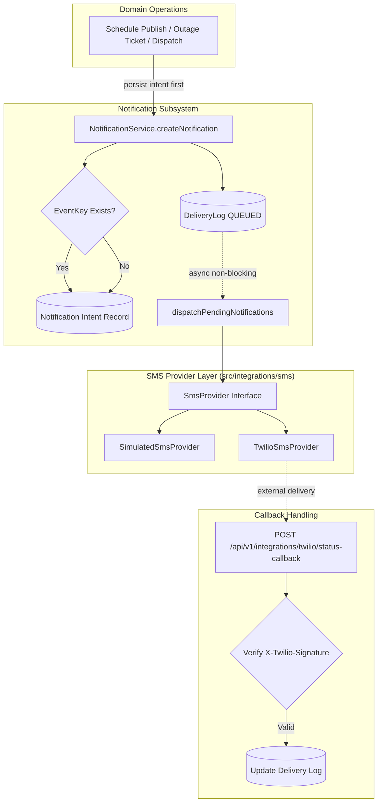

# Phase 16: Notification Delivery, Twilio Adapter, Retry, and Callback Handling

## Architectural Overview

Phase 16 establishes a resilient, decoupled notification delivery subsystem that guarantees **zero-impact failure isolation**: external SMS provider downtime never blocks, rolls back, or corrupts domain transactions (such as load shedding schedule publication, customer outage reporting, or technician dispatch).



---

## 1. Strict Provider Abstraction (`src/integrations/sms/`)

Controllers, routers, and domain services never import the Twilio SDK directly. All SMS communication is routed through the `SmsProvider` interface:

```typescript
export interface SmsSendOptions {
  to: string;
  body: string;
  idempotencyKey?: string;
}

export interface SmsSendResult {
  success: boolean;
  messageId?: string;
  error?: string;
  isPermanentError?: boolean;
}

export interface SmsProvider {
  send(options: SmsSendOptions): Promise<SmsSendResult>;
}
```

- **`TwilioSmsProvider`**: Dynamically loads Twilio credentials and validates phone numbers in E.164 format. Provides static HMAC-SHA1 signature verification for webhooks.
- **`SimulatedSmsProvider`**: In-memory fake provider for development, CI/CD, and test environments. Simulates network success, transient carrier failures, and permanent error conditions without external network traffic.
- **`getSmsProvider()`**: Provider factory resolving `TwilioSmsProvider` in production when credentials are provided, or `SimulatedSmsProvider` otherwise. Test overrides can be injected via `setSmsProviderForTesting()`.

---

## 2. Domain Transaction & Error Isolation

When an operator publishes a schedule or a customer reports an unexpected fault:
1. The domain entity (`Schedule`, `OutageTicket`) is committed to the database.
2. The in-app `NotificationRecord` is persisted with an unread state (`isRead: false`).
3. An SMS delivery log (`NotificationDeliveryLogRecord`) is enqueued with `status: DeliveryStatus.QUEUED`.
4. Asynchronous dispatch is triggered in the background. If the SMS provider is unreachable or rejects the message, the error is recorded on the delivery log. **The committed domain transaction is never rolled back**.

---

## 3. Logical Event Deduplication (`eventKey`)

To prevent duplicate customer alerts during job retries, bulk publishes, or duplicate triggers:
- `createNotification(..., eventKey?: string | null)` accepts an optional logical event key (e.g. `sched_pub:${scheduleId}:${userId}`).
- If an intent with the same `(userId, eventKey)` already exists in `store.notifications`, the service reuses the existing intent and does **not** generate duplicate SMS logs.

---

## 4. Concurrency-Safe Bounded Retries with Exponential Backoff

The notification dispatcher enforces bounded retries for transient carrier timeouts:
1. **Concurrency Claim**: The delivery log's status is atomically moved to `SENDING` before initiating transmission.
2. **Transient Failures**:
   - `attempts` is incremented.
   - If `attempts < 3`: status remains `QUEUED` and `nextAttemptAt` is scheduled with exponential backoff:
     $$\text{backoffMs} = 2^{\text{attempts}} \times 1000\text{ ms}$$
3. **Permanent Failures**:
   - Reaching 3 attempts or receiving a permanent error code (e.g. non-E.164 destination format) immediately transitions status to `FAILED` without hot-looping.

---

## 5. Signed Twilio Status Callback Webhook

### Route Contract
`POST /api/v1/integrations/twilio/status-callback`

### Security & Invariants
1. **Signature Verification**:
   - Verifies the `X-Twilio-Signature` header using HMAC-SHA1 against `TWILIO_AUTH_TOKEN` across the full canonical URL and alphabetically sorted POST parameters.
   - Invalid signatures are rejected with **`403 FORBIDDEN` (`INVALID_SIGNATURE`)**.
2. **Message Validation**:
   - `MessageSid` is validated against known delivery logs (`store.notificationDeliveryLogs`). Unknown SIDs are rejected with `404 DELIVERY_LOG_NOT_FOUND`.
3. **Monotonic Status Transitions**:
   - Incoming `'delivered'` transitions status to `DELIVERED` and stamps `deliveredAt`.
   - Incoming `'failed'` or `'undelivered'` transitions status to `FAILED`.
   - Out-of-order `'sent'` callbacks arriving after a `'delivered'` callback are ignored to prevent downgrading terminal delivery states.

---

## 6. Separate In-App Read State vs SMS Delivery State

In-app read state and SMS transmission state are strictly segregated:

| Dimension | In-App Notification (`NotificationRecord`) | SMS Delivery (`NotificationDeliveryLogRecord`) |
|---|---|---|
| **Primary Status** | `isRead: boolean`, `readAt: string \| null` | `status: DeliveryStatus` (`QUEUED`, `SENDING`, `SENT`, `DELIVERED`, `FAILED`) |
| **Mutation Actor** | Recipient User (`PATCH /users/me/notifications/:id/read`) | SMS Dispatcher & Twilio Webhook |
| **Lifecycle** | Persists until account deletion | Retained for audit and operational monitoring |

---

## 7. Verification Evidence

The Phase 16 test suite in `apps/api/src/test/runner.ts` verifies:
- ✅ `SmsProvider: Direct send via SimulatedSmsProvider returns success and valid messageId`
- ✅ `SmsProvider: Non-E.164 formatted number returns permanent error`
- ✅ `NotificationTemplates: Centralized templates format expected domain messages`
- ✅ `Notification Deduplication: Identical eventKey reuses intent and prevents duplicate SMS delivery logs`
- ✅ `SMS Error Isolation: Transient failure schedules retry with exponential backoff without crashing`
- ✅ `Bounded Retries: Max attempts (3) transitions delivery status to FAILED`
- ✅ `Twilio Webhook: Invalid X-Twilio-Signature is strictly rejected with 403 INVALID_SIGNATURE`
- ✅ `Twilio Webhook: Unrecognized MessageSid returns 404 DELIVERY_LOG_NOT_FOUND`
- ✅ `Twilio Webhook: Valid signed delivered status callback updates delivery log to DELIVERED with timestamp`
- ✅ `Twilio Webhook: Out-of-order callback protection prevents DELIVERED from downgrading to SENT`
- ✅ `GET /api/v1/admin/notifications reflects updated delivery logs and status transitions`
- **Total Test Suite**: 185 PASSED, 0 FAILED.
