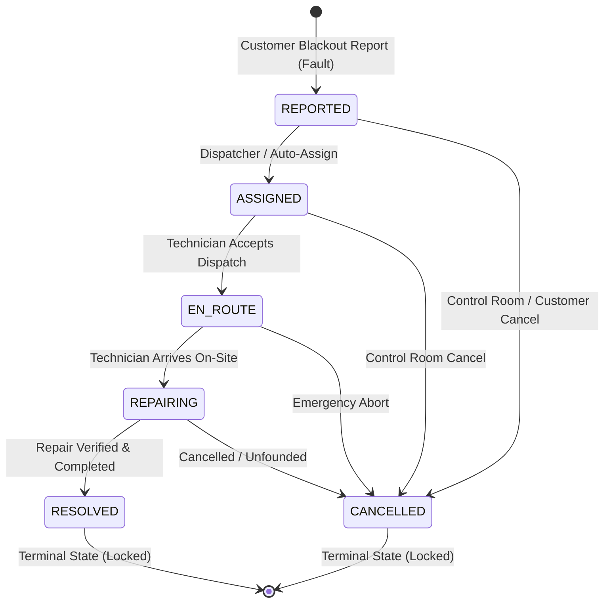

# Outage State Machine, Technician Assignment, and Dispatch Queue Architecture

## Overview
Phase 18 introduces a strict transactional state machine for Outage Tickets (`OutageTicket`), an intelligent least-busy deterministic technician auto-assignment engine, and canonical dispatch query and management endpoints (`/api/v1/outages`).

The outage management lifecycle bridges customer reporting, control room dispatch oversight, field technician execution, and automated grid telemetry updates.

---

## Outage Lifecycle State Machine

### Transition Invariants
1. **Legal Transitions Only**:
   - `REPORTED` $\to$ `ASSIGNED` | `CANCELLED`
   - `ASSIGNED` $\to$ `EN_ROUTE` | `CANCELLED`
   - `EN_ROUTE` $\to$ `REPAIRING` | `CANCELLED`
   - `REPAIRING` $\to$ `RESOLVED` | `CANCELLED`
   - Any attempt to bypass steps (e.g., `REPORTED` $\to$ `RESOLVED`) is rejected with HTTP 409 `INVALID_STATE_TRANSITION`.
2. **Terminal State Immutability**:
   - Tickets in `RESOLVED` or `CANCELLED` states cannot undergo any further state transitions (HTTP 409 `INVALID_STATE_TRANSITION`).
3. **Milestone Timestamp Stamping**:
   - Every transition stamps milestone fields: `assignedAt`, `enRouteAt`, `repairingAt`, `resolvedAt`, or `cancelledAt`.
4. **Feeder Online Telemetry Restoration**:
   - When a ticket transitions to `RESOLVED` or `CANCELLED`, the system checks whether any other active tickets remain on that feeder. If no other active faults remain, the feeder status automatically transitions back to `FeederStatus.ONLINE`.

---

## Technician Assignment & Dispatch Queue

### 1. Zone Boundary Enforcement
Field technicians operate within designated geographic service territories. Attempting to assign a technician from a foreign zone to a feeder ticket in another zone is strictly rejected with HTTP 400 `ZONE_MISMATCH`, unless overridden by a global Administrator.

### 2. Single Active Assignment Invariant
A ticket may only have one active technician assignment at any time. When a ticket is reassigned to another technician, the previous assignment record is immediately marked as `AssignmentStatus.REASSIGNED`, and the new assignment is set to `PENDING`.

### 3. Deterministic Least-Busy Auto-Assignment Engine
When operators trigger auto-assignment (`POST /api/v1/outages/:id/auto-assign`):
1. **Candidate Discovery**: Queries all active, non-deleted technicians assigned to the ticket's zone (`user.assignedZoneId === ticket.zoneId`).
2. **Multi-Factor Ranking**:
   - **Criterion 1 (Workload)**: Fewest active assignments (`status IN ['PENDING', 'ACCEPTED', 'IN_PROGRESS']`).
   - **Criterion 2 (Round-Robin Equity)**: Least recently assigned technician (oldest `lastAssignedAt` timestamp; never-assigned technicians take highest precedence).
   - **Criterion 3 (Deterministic Tie-Breaker)**: Technician user ID ascending (`a.id.localeCompare(b.id)`).
3. **Execution**: Automatically delegates to `assignTechnician`, transitioning the ticket to `ASSIGNED`, dispatching a real-time Socket.io event, and queuing a dispatch notification/SMS.

---

## Canonical Outage API Routes

| Method | Endpoint | Access | Purpose |
| :--- | :--- | :--- | :--- |
| `GET` | `/api/v1/outages` | Authenticated (Scoped) | Query and filter tickets (`status`, `feederId`, `zoneId`, `faultType`) with pagination |
| `GET` | `/api/v1/outages/:id` | Authenticated (Scoped) | Enriched ticket detail (`OutageDetailDto`) with technician, feeder, zone, and history |
| `GET` | `/api/v1/outages/:id/history` | Authenticated (Scoped) | Chronological status history (`OutageStatusHistoryDto`) with actor names and notes |
| `POST` | `/api/v1/outages/:id/cancel` | Operator / Admin / Manager | Transition ticket to `CANCELLED` with mandatory reason |
| `POST` | `/api/v1/outages/:id/assign` | Operator / Admin / Manager | Manual technician assignment with zone enforcement |
| `POST` | `/api/v1/outages/:id/auto-assign` | Operator / Admin / Manager | Deterministic least-busy automated dispatch |

---

## Automated Verification Suite

The state machine and dispatch engine are formally verified by 16 dedicated test assertions in `apps/api/src/test/runner.ts`:
- ✅ `State Machine Invariant: Illegal transition REPORTED -> RESOLVED rejected with 409 INVALID_STATE_TRANSITION`
- ✅ `Dispatch Invariant: Non-admin assigning technician from foreign zone rejected with 400 ZONE_MISMATCH`
- ✅ `Dispatch Invariant: Assigning non-technician user rejected with 400 INVALID_TECHNICIAN`
- ✅ `State Machine: Transition REPORTED -> ASSIGNED stamps assignedAt and sets technician`
- ✅ `Single Active Assignment: Reassignment sets prior technician assignment to REASSIGNED and new to PENDING`
- ✅ `State Machine: ASSIGNED -> EN_ROUTE stamps enRouteAt and marks assignment ACCEPTED`
- ✅ `State Machine: EN_ROUTE -> REPAIRING stamps repairingAt and marks assignment IN_PROGRESS`
- ✅ `State Machine: REPAIRING -> RESOLVED stamps resolvedAt, completes assignment, and restores feeder to ONLINE`
- ✅ `Terminal Lock: Attempting to transition from RESOLVED status rejected with 409 INVALID_STATE_TRANSITION`
- ✅ `Cancellation Route: POST /api/v1/outages/:id/cancel transitions ticket to CANCELLED with timestamp`
- ✅ `Terminal Lock: Transitioning CANCELLED ticket rejected with 409 INVALID_STATE_TRANSITION`
- ✅ `Auto-Assignment: Deterministic least-busy engine assigns available Technician Beta (0 active vs Alpha 1 active)`
- ✅ `Canonical Detail: GET /api/v1/outages/:id returns fully enriched OutageDetailDto`
- ✅ `Canonical History: GET /api/v1/outages/:id/history returns complete chronological status and actor trail`
- ✅ `Outage List & Filters: GET /api/v1/outages supports status filtering and PaginatedData response envelope`
- ✅ `Canonical Outages IDOR: Customer accessing unowned ticket rejected with 404 TICKET_NOT_FOUND`
