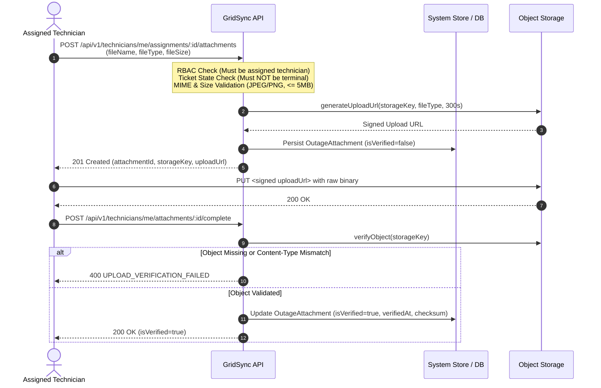

# Private Repair-Photo Attachments and Resolution Evidence Architecture (Phase 19)

---

## 1. Executive Summary

Phase 19 establishes a zero-trust, private object-storage architecture for repair photos and enforces an unbypassable resolution evidence gate on power outage tickets. Operational field staff cannot resolve an outage ticket without submitting verified technical photographic evidence and substantive resolution notes ($\ge 5$ characters). Direct public access to technical repair evidence is prohibited; all photo uploads and downloads are governed by time-bounded, cryptographically signed URLs with strict Role-Based Access Control (RBAC).

---

## 2. Core Architectural Pillars

### 2.1 Provider-Neutral Object Storage Abstraction

To avoid cloud vendor lock-in (e.g. AWS S3, Google Cloud Storage, Azure Blob Storage, MinIO), the backend implements an `ObjectStorageProvider` interface:

```typescript
export interface StorageObjectMetadata {
  exists: boolean;
  sizeBytes: number;
  contentType: string;
  checksum?: string;
}

export interface SignedUploadUrlResult {
  uploadUrl: string;
  key: string;
  headers?: Record<string, string>;
}

export interface ObjectStorageProvider {
  generateUploadUrl(key: string, contentType: string, expiresInSeconds?: number): Promise<SignedUploadUrlResult>;
  verifyObject(key: string): Promise<StorageObjectMetadata>;
  generateDownloadUrl(key: string, expiresInSeconds?: number): Promise<string>;
  putObject(key: string, data: Buffer, contentType: string): Promise<void>;
  getObject(key: string): Promise<{ data: Buffer; contentType: string } | null>;
  deleteObject(key: string): Promise<void>;
  validateToken(key: string, token: string, expiresTimestamp: number): boolean;
}
```

The default `SimulatedStorageProvider` provides local disk mirroring and HMAC-SHA256 signature generation/validation for local development and continuous integration environments, completely eliminating external cloud storage dependencies during automated testing.

### 2.2 Server-Controlled Storage Keys & HMAC Signatures

To prevent path traversal, IDOR, or accidental overwrites, clients **never** specify storage keys or file paths. The server deterministically generates canonical keys following the pattern:

$$\text{storageKey} = \text{repair-photos}/\langle\text{ticketId}\rangle/\langle\text{attachmentId}\rangle.\langle\text{ext}\rangle$$

Upload and download URLs include an HMAC-SHA256 signature generated over the key and expiration timestamp:

$$\text{token} = \text{HMAC-SHA256}(K_{\text{secret}}, \text{key} \mathbin{\Vert} \text{expiresTimestamp})$$

* **Upload Expiration Window:** 300 seconds (5 minutes).
* **Download Expiration Window:** 900 seconds (15 minutes).
* **Timing-Safe Verification:** Validation uses `crypto.timingSafeEqual` to prevent side-channel timing attacks.

---

## 3. End-to-End Upload Lifecycle



---

## 4. Mandatory Resolution Evidence Gate

When an outage ticket is transitioned to `RESOLVED` (via `POST /api/technicians/me/assignments/:id/resolve` or `outageService.transitionTicket`), the system executes a strict verification gate before allowing state mutation:

1. **Verified Evidence Requirement:**
   The ticket must have at least one verified attachment linked directly to its `ticketId`:
   $$\exists a \in \text{store.outageAttachments} : a.\text{ticketId} = t.\text{id} \land a.\text{isVerified} = \text{true}$$
   If no verified photo exists, the transition is rejected with:
   $$\text{HTTP } 422 \quad \text{code: } \texttt{REPAIR\_EVIDENCE\_REQUIRED}$$

2. **Resolution Notes Requirement:**
   The technician must provide substantive resolution notes explaining the corrective action taken ($\ge 5$ characters). If empty or whitespace-only, the transition is rejected with:
   $$\text{HTTP } 422 \quad \text{code: } \texttt{RESOLUTION\_NOTES\_REQUIRED}$$

3. **Cross-Ticket Isolation:**
   Verified photos on Ticket $A$ cannot satisfy the resolution gate for Ticket $B$. Attachment records strictly belong to their originating ticket.

---

## 5. Security & Access Control Matrix

| Endpoint | Method | Permitted Roles | Scoping / Isolation Rules |
| :--- | :---: | :--- | :--- |
| `/api/v1/technicians/me/assignments/:id/attachments` | `POST` | `TECHNICIAN` | Only the technician actively assigned to the assignment can initiate uploads. |
| `/api/v1/technicians/me/attachments/:id/complete` | `POST` | `TECHNICIAN` | Only the uploader of the attachment can mark it complete. |
| `/api/v1/outages/:id/attachments` | `GET` | `ADMIN`, `OPERATOR`, `ZONE_MANAGER`, `TECHNICIAN` | Returns verified attachments with signed download URLs. Customers receive `403 FORBIDDEN`. Technicians restricted to assigned tickets. Zone Managers restricted to zone. |
| `/api/v1/storage/upload` | `PUT` | Public with Signed URL | HMAC signature and expiration timestamp validated against `authSecret`. |
| `/api/v1/storage/download` | `GET` | Public with Signed URL | HMAC signature and expiration timestamp validated against `authSecret`. |

---

## 6. Automated Verification Summary

The automated test runner (`apps/api/src/test/runner.ts`) verifies the entire Phase 19 specification across 14 dedicated test assertions:

1. **File Type Rejection:** Non-JPEG/PNG uploads rejected with HTTP 400 `INVALID_FILE_TYPE`.
2. **File Size Limit:** Files $> 5\text{ MB}$ rejected with HTTP 400 `FILE_TOO_LARGE`.
3. **Technician Authorization:** Unassigned technicians rejected with HTTP 403 `NOT_ASSIGNED_TECHNICIAN`.
4. **Signed Upload URL:** Successfully generates short-lived upload URL with server-controlled storage key.
5. **Forged Completion Rejection:** Marking complete before binary upload rejected with HTTP 400 `UPLOAD_VERIFICATION_FAILED`.
6. **Direct Binary Upload:** Successfully uploads image binary directly to the signed upload URL.
7. **Verification & Completion:** Verifies stored binary in storage and marks attachment `isVerified = true`.
8. **Resolution Gate Enforcement:** Attempting to resolve without verified evidence rejected with HTTP 422 `REPAIR_EVIDENCE_REQUIRED`.
9. **Resolution Notes Enforcement:** Attempting to resolve with empty notes rejected with HTTP 422 `RESOLUTION_NOTES_REQUIRED`.
10. **Resolution Success:** Ticket with verified repair evidence and notes transitions to `RESOLVED`.
11. **Cross-Ticket Isolation:** Evidence on Ticket A cannot satisfy resolution gate for Ticket B.
12. **Scoped Attachment Retrieval:** Operational staff retrieve verified photos with short-lived signed download URLs.
13. **Binary Download via Signed URL:** Successfully downloads stored image binary using signed download URL.
14. **Customer Access Restriction:** Customers attempting to access internal technical repair photos rejected with HTTP 403 `FORBIDDEN`.
