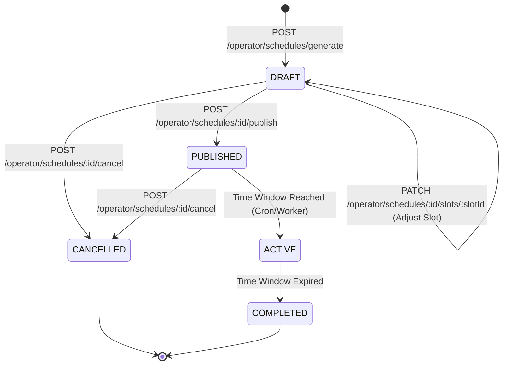
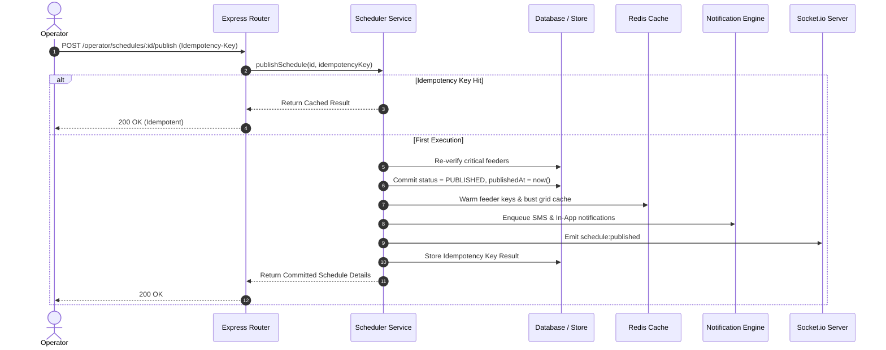

# Schedule Lifecycle, State Machine, Audit Trails, and Feeder Queries

## 1. Overview
The schedule management system provides an end-to-end, transactional, and strictly validated lifecycle for planned power rotations across Bangladesh power distribution grids.

It translates outputs generated by the deterministic **Fair-Rotation Scheduling Engine** into persistent operational entities, provides review and manual slot adjustment mechanisms, enforces grid safety laws at all mutation points, guarantees idempotent publication with customer notifications, and exposes role-scoped feeder schedule read models.

---

## 2. Schedule Lifecycle State Machine

### State Transition Rules & Rejections
1. **`DRAFT`:**
   - Initial state upon schedule generation.
   - Non-operational metadata (`notes`) can be updated via `PATCH /api/v1/operator/schedules/:id`.
   - Discrete slots can be manually adjusted via `PATCH /api/v1/operator/schedules/:id/slots/:slotId`.
   - Allowed outgoing transitions: `PUBLISHED`, `CANCELLED`.
2. **`PUBLISHED`:**
   - Transition triggered by `POST /api/v1/operator/schedules/:id/publish`.
   - Cannot mutate metadata or slots (`409 INVALID_STATE_TRANSITION`).
   - Re-publishing an already published schedule without an idempotency key is rejected with `409 INVALID_STATE_TRANSITION`.
   - Allowed outgoing transitions: `ACTIVE`, `CANCELLED`.
3. **`CANCELLED`:**
   - Terminal cancellation state triggered by `POST /api/v1/operator/schedules/:id/cancel`.
   - Attempting to publish or re-cancel a cancelled schedule is strictly rejected with `409 INVALID_STATE_TRANSITION`.
4. **`COMPLETED`:**
   - Terminal completion state once operational time window expires.
   - Cannot be cancelled (`409 INVALID_STATE_TRANSITION`).

---

## 3. Manual Slot Adjustment Grid Safety Validation

When an operator manually updates the assigned feeders for a draft slot (`PATCH /api/v1/operator/schedules/:id/slots/:slotId`), the backend enforces safety checks before committing changes:

1. **Grid Law 1 (Critical Feeder Immunity):**
   - Critical feeders (e.g., `FDR-DHN-HOSP` / Hospital lines) are immune from scheduled load shedding.
   - If an operator attempts to include a feeder with `isCritical: true`, the API rejects the request with **`400 CRITICAL_FEEDER_PROTECTED`**.
2. **Grid Law 2 (Same-Day Single-Cut Rule):**
   - A feeder cannot undergo load shedding twice in the same calendar day.
   - The validator verifies:
     - The feeder is not already assigned to another slot in the same schedule.
     - The feeder is not assigned to any other `PUBLISHED` schedule on that `planningDate`.
   - If violated, the API rejects the request with **`400 FEEDER_ALREADY_COMMITTED`**.
3. **Feeder Operational Status:**
   - Feeders marked as `deletedAt` or active hardware faults cannot be assigned to scheduled cuts.

---

## 4. Publish Idempotency & Side-Effect Ordering

Publishing a draft schedule initiates customer-facing events:

---

## 5. Audit Trail Specification (`ScheduleGenerationRun`)

Every execution of the draft generation algorithm creates an immutable audit record:

| Field | Type | Description |
|---|---|---|
| `id` | `String` | Unique execution identifier (`sgr_{scheduleId}`) |
| `scheduleId` | `String` | Associated `LoadSheddingSchedule` ID |
| `operatorId` | `String` | User ID of the operator who triggered the run |
| `planningDate` | `String` | Calendar date target (`YYYY-MM-DD`) |
| `algorithmVersion` | `String` | Version identifier (e.g. `v1.0.0-fair-rotation`) |
| `targetDeficitMW` | `Float` | Target deficit load shed required |
| `selectedMW` | `Float` | Total actual MW allocated across all slots |
| `shortfallMW` | `Float` | Cumulative shortfall MW ($\max(0, \text{target} - \text{selected})$) |
| `totalSlots` | `Int` | Count of discrete time slots generated |
| `eligibleFeedersCount` | `Int` | Eligible candidate feeders considered |
| `criticalExcludedCount`| `Int` | Critical feeders protected and excluded |
| `sameDayExcludedCount` | `Int` | Feeders excluded due to prior same-day cuts |
| `diagnostics` | `JSON` | Detailed algorithm metrics and shortfall MWh |
| `createdAt` | `DateTime` | Timestamp of execution |

---

## 6. Authorized Feeder Schedule Query (`GET /api/v1/schedules/feeders/:feederId`)

Exposes a query model for examining upcoming and historical load-shedding slots for a specific feeder:

1. **RBAC & Zone Isolation:**
   - **`ADMIN` & `POWER_OPERATOR`:** Global access across all feeders; can view both `DRAFT` and `PUBLISHED` schedules.
   - **`ZONE_MANAGER`:** Access restricted strictly to feeders belonging to their assigned zone (`assignedZoneId`). Cross-zone queries return **`403 FORBIDDEN`**.
   - **`CUSTOMER`:** Can view published schedules affecting their feeder. **Draft schedules are strictly omitted**.
2. **Filtering Parameters:**
   - `startDate`: Bounded start date (`YYYY-MM-DD`).
   - `endDate`: Bounded end date (`YYYY-MM-DD`).
   - `status`: Filter by schedule status (`PUBLISHED`, `DRAFT`, `CANCELLED`).
