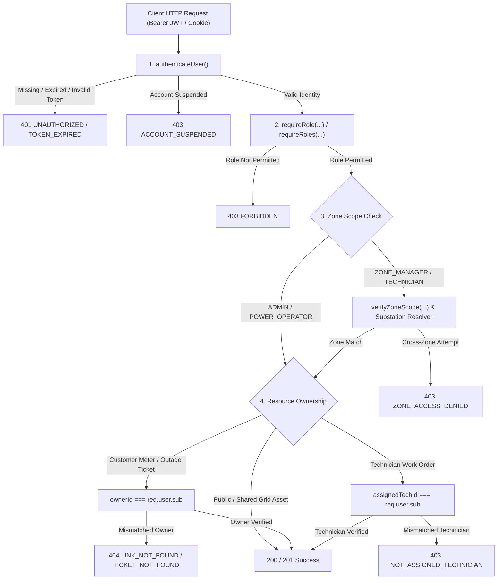

# Security & Authorization Architecture

## 1. Overview & Objectives

The Smart Load Shedding & Grid Balancing platform implements a defense-in-depth authorization pipeline ensuring that only authenticated, authorized, and zone-verified actors can view or mutate electrical grid assets.

The security architecture enforces three distinct layers of access control:
1. **Vertical Role-Based Access Control (RBAC):** Strict boundaries separating five hierarchical user roles.
2. **Horizontal Zone-Scope Isolation:** Strict geographic boundaries preventing regional managers and field workers from accessing or modifying grid assets outside their designated jurisdiction.
3. **Object-Level Resource Ownership (IDOR Prevention):** Explicit ownership verification on sensitive assets (smart meter links, private outage tickets, repair dispatches) with silent denials (`404 NOT_FOUND`) to prevent enumeration attacks.

---

## 2. Authorization Pipeline & Request Lifecycle

Every inbound HTTP request targeting protected endpoints flows sequentially through the three verification layers:



---

## 3. Platform RBAC Matrix

The system governs access across five functional personas:

| Domain / Resource | Operation | ADMIN | POWER_OPERATOR | ZONE_MANAGER | TECHNICIAN | CUSTOMER |
| :--- | :--- | :---: | :---: | :---: | :---: | :---: |
| **Grid Topology** | Create/Update Zones, Substations, Feeders | ✅ Full | ❌ Read Only | ❌ Read Only | ❌ Read Only | ❌ Read Only |
| **User Administration** | Provision Staff, Suspend, Reactivate Users | ✅ Full | ❌ Denied | ❌ Denied | ❌ Denied | ❌ Denied |
| **Audit Logs** | Inspect System Audit Logs | ✅ Full | ❌ Denied | ❌ Denied | ❌ Denied | ❌ Denied |
| **Scheduling Engine** | Generate Algorithmic Draft Schedules | ✅ Full | ✅ Full | ❌ Denied | ❌ Denied | ❌ Denied |
| **Schedule Control** | Publish or Cancel Load Shedding Plans | ✅ Full | ✅ Full | ❌ Denied | ❌ Denied | ❌ Denied |
| **Emergency Outage** | Operator Feeder Trip / Manual Cut | ✅ Full | ✅ Full | ❌ Denied | ❌ Denied | ❌ Denied |
| **Outage Dispatch** | Assign Field Technician to Outage Ticket | ✅ Full | ✅ Full | ✅ In Zone | ❌ Denied | ❌ Denied |
| **Upgrade Requests** | Submit Feeder Infrastructure Upgrades | ✅ Universal | ❌ Denied | ✅ In Zone Only | ❌ Denied | ❌ Denied |
| **Upgrade Decisions** | Approve or Reject Upgrade Requests | ✅ Full | ❌ Denied | ❌ Denied | ❌ Denied | ❌ Denied |
| **Work Orders** | Accept, Commence, and Resolve Repairs | ✅ Override | ❌ Denied | ❌ Denied | ✅ Assigned Only | ❌ Denied |
| **Meter Management** | Link, Nickname, or Unlink Smart Meter | ✅ Full | ❌ Denied | ❌ Denied | ❌ Denied | ✅ Owned Only |
| **Outage Reporting** | Submit Smart Outage Report (Self) | ✅ Full | ❌ Denied | ❌ Denied | ❌ Denied | ✅ Owned Meter |
| **Consumer Schedule** | Query Household Feeder Outage Schedule | ✅ Full | ✅ Full | ✅ Full | ✅ Full | ✅ Owned Meter |

---

## 4. Horizontal Zone-Scope Isolation

To enforce multi-tenant geographic security within a single electrical utility:
- Every `UserRecord` of role `ZONE_MANAGER` or `TECHNICIAN` stores an `assignedZoneId`.
- The JWT payload encapsulates `zoneId?: string | null`.

### Isolation Safeguards
1. **Infrastructure Upgrade Requests (`POST /api/infrastructure-requests`):**
   - The handler inspects the target feeder:
     ```typescript
     if (req.user.role === UserRole.ZONE_MANAGER) {
       const feeder = store.feeders.get(data.feederId);
       const substation = store.substations.get(feeder.substationId);
       if (!substation || substation.zoneId !== req.user.zoneId) {
         throw new ForbiddenError(
           'Forbidden: You can only submit upgrade requests for feeders within your assigned zone',
           'ZONE_ACCESS_DENIED'
         );
       }
     }
     ```
2. **Technician & Ticket Dispatch:**
   - Zone Managers can only inspect and assign tickets associated with feeders originating from substations situated within their `assignedZoneId`.
3. **Global Bypass:**
   - `ADMIN` and `POWER_OPERATOR` accounts possess universal grid visibility and can operate across all zones without geographic constraint.

---

## 5. Insecure Direct Object Reference (IDOR) Protections

To protect consumer privacy and operational integrity against probing and enumeration attacks:

### 1. Smart Meter Link Ownership (`DELETE /api/customers/me/meters/:id`)
When unlinking a meter, the route matches `link.customerId === req.user.sub`:
- If an unauthenticated user or an unauthorized customer attempts to unlink another resident's meter ID, the system responds with `404 LINK_NOT_FOUND` rather than `403 FORBIDDEN`.
- **Security Rationale:** Emitting `403 FORBIDDEN` leaks information confirming the targeted ID exists. Emitting `404 NOT_FOUND` renders customer meter identifiers non-enumerable.

### 2. Outage Ticket Confidentiality (`GET /api/customers/me/outage-reports/:id`)
Consumers may only inspect fault reports submitted by their own account:
- If `ticket.customerId !== req.user.sub`, the API immediately raises `404 TICKET_NOT_FOUND`.

### 3. Technician Work Order Exclusivity (`POST /api/technicians/me/assignments/:id/accept`)
Field technicians are assigned to critical high-voltage repairs. To prevent unauthorized technicians from interfering with another crew's dispatch:
- If `assignment.technicianId !== req.user.sub && req.user.role !== UserRole.ADMIN`, the API rejects the transition with `403 NOT_ASSIGNED_TECHNICIAN`.

---

## 6. Security Error Taxonomy

All authorization exceptions map directly to Phase 6 error classes and standardized payloads:

| HTTP Status | Error Class | Error Code | Example Trigger |
| :---: | :--- | :--- | :--- |
| **401** | `UnauthorizedError` | `UNAUTHORIZED` | Missing Bearer token or cookie |
| **401** | `UnauthorizedError` | `TOKEN_EXPIRED` | Expired JWT session |
| **401** | `UnauthorizedError` | `INVALID_TOKEN` | Tampered cryptographic signature |
| **403** | `ForbiddenError` | `FORBIDDEN` | Customer attempting to draft schedules or create zones |
| **403** | `ForbiddenError` | `ACCOUNT_SUSPENDED` | Account suspended by system administrator |
| **403** | `ForbiddenError` | `ZONE_ACCESS_DENIED` | Zone Manager submitting upgrade for foreign feeder |
| **403** | `ForbiddenError` | `NOT_ASSIGNED_TECHNICIAN` | Technician attempting to accept another worker's dispatch |
| **404** | `NotFoundError` | `LINK_NOT_FOUND` | IDOR shield on customer meter links |
| **404** | `NotFoundError` | `TICKET_NOT_FOUND` | IDOR shield on customer outage reports |

---

## 7. Automated Test Verification Evidence

The entire authorization surface is automatically verified by Test 15 in `apps/api/src/test/runner.ts`:

- **Test 15a:** Customer blocked from Operator draft schedule &rarr; `403 FORBIDDEN`
- **Test 15b:** Field Technician blocked from Admin zone creation &rarr; `403 FORBIDDEN`
- **Test 15c:** Zone Manager blocked from Admin user provisioning &rarr; `403 FORBIDDEN`
- **Test 15d:** Dhanmondi Zone Manager blocked from Mirpur feeder upgrade &rarr; `403 ZONE_ACCESS_DENIED`
- **Test 15e:** Dhanmondi Zone Manager permitted to request Dhanmondi feeder upgrade &rarr; `201 CREATED`
- **Test 15f:** Customer B blocked from unlinking Customer A's meter &rarr; `404 LINK_NOT_FOUND`
- **Test 15g:** Customer B blocked from inspecting Customer A's private ticket &rarr; `404 TICKET_NOT_FOUND`
- **Test 15h:** Technician 2 blocked from accepting Technician 1's assigned work order &rarr; `403 NOT_ASSIGNED_TECHNICIAN`
- **Test 15i:** Unit test direct invocation of `requireRole` and `verifyZoneScope` middleware functions
