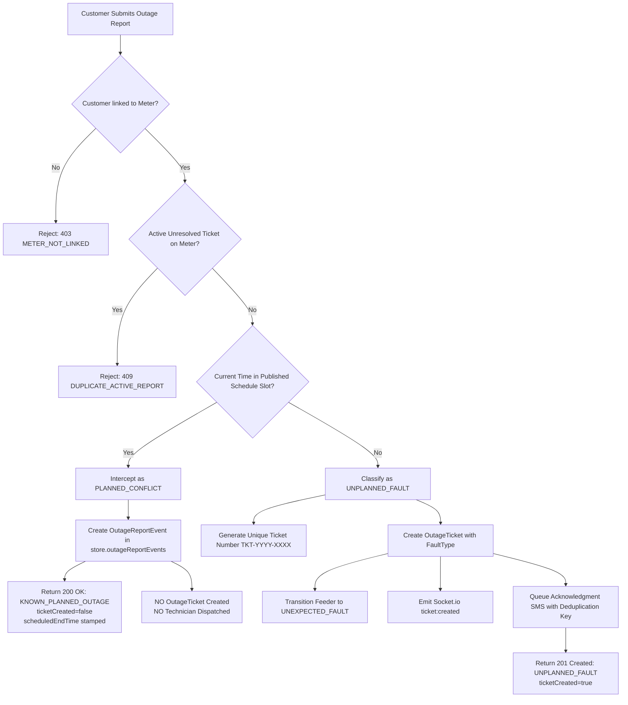

# Smart Outage Reporting and Planned-Conflict Resolution Architecture

## Overview
Phase 17 delivers intelligent classification and filtering for customer-reported power outages. When customers experience a blackout, their immediate instinct is to report a power outage. However, in a national grid experiencing scheduled load shedding, a substantial proportion of outages are planned events rather than unexpected physical equipment failures. 

Dispatching emergency repair technicians to investigate planned load-shedding events exhausts scarce utility resources and causes unnecessary operational costs. The **Smart Conflict Resolution Engine** intercepts customer reports, evaluates active schedule windows across grid feeder assignments, and transparently informs customers while preserving audit compliance.

---

## Conflict Resolution Logic & Decision Flow

---

## Key Invariants & Safeguards

1. **Active Published Slot Interception (Case A)**:
   - Evaluates all `PUBLISHED` schedules covering the current timestamp: `slot.startTime <= now <= slot.endTime`.
   - Checks if the customer's meter is connected to a feeder assigned to the active slot.
   - If satisfied, immediately classifies as `KNOWN_PLANNED_OUTAGE` with `isPlanned: true` and `ticketCreated: false`.
   - Calculates and returns `scheduledEndTime`.
   - Persists an immutable `OutageReportEventRecord` (`classification: 'PLANNED_CONFLICT'`) for auditing and customer history.
   - Guarantees **no** `OutageTicket` is generated and **no** field technician is dispatched.

2. **Expired / Inactive Schedule Slot Immunity (Case B)**:
   - If an outage occurs outside a published slot, or if a schedule was cancelled, the report proceeds to create a genuine `OutageTicket`.
   - Assigns initial status `REPORTED` and records an initial `OutageStatusHistoryRecord`.
   - Stamps the user-specified `FaultType` (`TRANSFORMER`, `LINE_DOWN`, `CABLE_FAULT`, `METER_FAULT`, `OTHER`).
   - Updates feeder status to `UNEXPECTED_FAULT` to alert SCADA operators.
   - Queues customer SMS acknowledgment using `NotificationTemplates.outageAcknowledged` and deduplication key `ticket_ack:{ticketId}`.

3. **Duplicate Active Report Suppression**:
   - If an active, unresolved ticket (`status NOT IN ['RESOLVED', 'CANCELLED']`) already exists for the customer's meter, subsequent report submissions are rejected with HTTP 409 `DUPLICATE_ACTIVE_REPORT`.
   - Prevents duplicate ticket spamming and duplicate technician dispatches for the same incident.

4. **Multi-Meter & Unified Customer History**:
   - Customer endpoint `GET /api/v1/customers/me/outage-reports` returns a chronological feed interleaving:
     - Unexpected fault tickets (`type: 'UNPLANNED_FAULT'`)
     - Intercepted planned conflict events (`type: 'PLANNED_CONFLICT'`)
   - Customer endpoint `GET /api/v1/customers/me/outage-reports/:id` retrieves either entity type with complete status, feeder, and address metadata.
   - Enforces strict tenant ownership: accessing tickets or conflict events belonging to other customers returns HTTP 404 `TICKET_NOT_FOUND`.

---

## Automated Verification Suite

The smart conflict resolution capabilities are validated by 9 dedicated test assertions in `apps/api/src/test/runner.ts`:
- ✅ `Smart Reporting IDOR: Submitting report on unlinked meter returns 403 METER_NOT_LINKED`
- ✅ `Planned Slot Interception: Active published schedule slot intercepts report with KNOWN_PLANNED_OUTAGE (no ticket created)`
- ✅ `Audit Persistence: OutageReportEvent record safely stored in store.outageReportEvents without creating OutageTicket`
- ✅ `Unexpected Fault: Unscheduled blackout creates OutageTicket with specified faultType and UNPLANNED_FAULT classification`
- ✅ `Duplicate Suppression: Subsequent report on meter with active in-flight ticket returns 409 DUPLICATE_ACTIVE_REPORT`
- ✅ `Unified Outage History: GET /api/customers/me/outage-reports returns chronological feed containing both faults and planned events`
- ✅ `Report Detail: GET /api/customers/me/outage-reports/:id retrieves full details for planned conflict event`
- ✅ `Report Detail: GET /api/customers/me/outage-reports/:id retrieves fault ticket details with history`
- ✅ `Report Inspection IDOR: Non-existent or foreign ticket returns 404 TICKET_NOT_FOUND`
