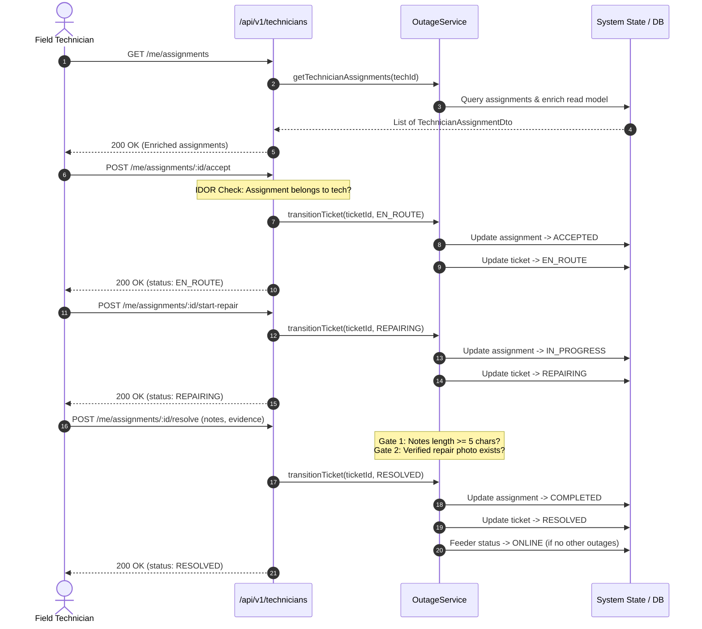
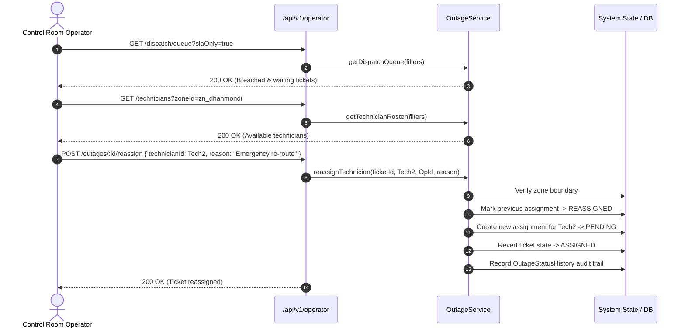

# Technician APIs, Operator Dispatch Oversight, and Ticket Read Models (Phase 20)

---

## 1. Executive Summary

Phase 20 formalizes the operational Field Technician workflow, real-time Operator Dispatch Oversight, and high-performance read-model projections for the National Load Shedding & Power Outage Management System. 

It establishes canonical REST endpoints (Endpoints 38–43 in [`docs/api.md`](file:///g:/programming/CSE-3110/Zarin-loadshading/docs/api.md)), enforces IDOR safeguards on field operations, integrates strict state machine progression (Phase 18) and photographic evidence validation gates (Phase 19), and equips control room operators with an SLA-aware dispatch queue, live technician roster, and in-flight ticket reassignment capabilities.

---

## 2. Architectural Pillars

```
                                      ┌─────────────────────────────────────────┐
                                      │        CONTROL ROOM OPERATORS           │
                                      └────────────────────┬────────────────────┘
                                                           │
                                   GET /api/v1/operator/dispatch/queue (SLA > 120m)
                                   GET /api/v1/operator/technicians (Roster & Load)
                                   POST /api/v1/operator/outages/:id/reassign
                                                           │
                                                           ▼
┌────────────────────────────────────────────────────────────────────────────────────────────────────────┐
│                                   GRID CONTROL & OUTAGE ENGINE                                         │
│                                                                                                        │
│   ┌───────────────────────────────┐  State Machine  ┌──────────────────────────────────────────────┐   │
│   │  Single Active Assignment     │ ──────────────> │ Evidence Gate (Phase 19)                     │   │
│   │  Supercedes older assignments │                 │ • Substantive notes (>= 5 chars)             │   │
│   │  Zone boundary enforcement    │                 │ • Verified photo attachment (HMAC signed)    │   │
│   └───────────────────────────────┘                 └──────────────────────────────────────────────┘   │
└────────────────────────────────────────────────────────────────────────────────────────────────────────┘
                                                           ▲
                                                           │
                                   GET /api/v1/technicians/me/assignments (Read Model)
                                   POST .../accept (ASSIGNED -> EN_ROUTE)
                                   POST .../start-repair (EN_ROUTE -> REPAIRING)
                                   POST .../resolve (REPAIRING -> RESOLVED)
                                   GET /api/v1/technicians/me/stats (KPIs)
                                                           │
                                      ┌────────────────────┴────────────────────┐
                                      │        FIELD CREW / TECHNICIANS         │
                                      └─────────────────────────────────────────┘
```

### 2.1 Canonical Field Technician Workflow (Endpoints 38–43)

Field technicians interact through authenticated `/api/v1/technicians/me/*` endpoints governed by the `TECHNICIAN` role and strict object-level ownership checks (IDOR protection):

1. **Assignment Read Model Projection (`GET /api/v1/technicians/me/assignments` - Endpoint 38):**
   Returns enriched `TechnicianAssignmentDto` records for all assignments linked to the authenticated technician. Enriches the core outage ticket with meter address, feeder details, substation name, zone identifiers, customer contact, and status history.
2. **Acceptance (`POST /api/v1/technicians/me/assignments/:id/accept` - Endpoint 39):**
   Transitions ticket from `ASSIGNED` to `EN_ROUTE`. Updates `TechnicianAssignment.status` to `ACCEPTED` and sets `acceptedAt = NOW()`.
3. **On-Site Repair Commencement (`POST /api/v1/technicians/me/assignments/:id/start-repair` - Endpoint 40):**
   Transitions ticket from `EN_ROUTE` to `REPAIRING`. Updates `TechnicianAssignment.status` to `IN_PROGRESS` and sets `startedAt = NOW()`.
4. **Repair Evidence Resolution (`POST /api/v1/technicians/me/assignments/:id/resolve` - Endpoint 42):**
   Transitions ticket from `REPAIRING` to `RESOLVED`.
   - Requires substantive `resolutionNotes` ($\ge 5$ characters).
   - Validates existence of at least one verified repair photo (`isVerified = true`).
   - Marks active assignment as `COMPLETED` with `completedAt = NOW()`.
   - Automatically restores associated feeder to `ONLINE` if no other active outages exist on that feeder.
   - Dispatches customer notification SMS and publishes real-time WebSocket events.
5. **Performance Statistics (`GET /api/v1/technicians/me/stats` - Endpoint 43):**
   Computes individual technician KPIs: active assignments count, lifetime resolved tickets, today's resolved count, and average repair duration in minutes (calculated between `startedAt` and `completedAt`).

### 2.2 Dual Parameter Resolution (`:id`)

To maximize field client ergonomics, the technician and operator routers transparently resolve `:id` whether provided as a `ticketId` (`tkt_*`) or an `assignmentId` (`asgn_*`) via the `resolveAssignmentAndTicket` helper:

```typescript
const resolveAssignmentAndTicket = (id: string, technicianId?: string) => {
  let assignment = store.technicianAssignments.get(id);
  let ticket: OutageTicketRecord | undefined;

  if (assignment) {
    ticket = store.outageTickets.get(assignment.ticketId);
  } else {
    ticket = store.outageTickets.get(id);
    if (ticket) {
      assignment = Array.from(store.technicianAssignments.values())
        .filter((a) => a.ticketId === ticket!.id && (!technicianId || a.technicianId === technicianId))
        .sort((a, b) => new Date(b.assignedAt).getTime() - new Date(a.assignedAt).getTime())[0];
    }
  }

  return { assignment, ticket };
};
```

---

## 3. Operator Dispatch Oversight

### 3.1 Real-Time Dispatch Queue (`GET /api/v1/operator/dispatch/queue`)

Provides control room operators with real-time operational visibility into all unresolved outages (`REPORTED`, `ASSIGNED`, `EN_ROUTE`, `REPAIRING`).

* **SLA Tracking:** Computes wait time dynamically:
  $$\text{minutesWaiting} = \left\lfloor \frac{t_{\text{now}} - t_{\text{reported}}}{60{,}000} \right\rfloor$$
* **SLA Breach Threshold:** Automatically flags tickets waiting $\ge 120$ minutes with `isSlaBreached = true`.
* **SLA Filter:** Supports `?slaOnly=true` query parameter for critical escalation triage.
* **Prioritization:** Orders tickets by SLA breach status descending, followed by longest waiting time descending.

### 3.2 Technician Availability Roster (`GET /api/v1/operator/technicians`)

Enables operators to inspect active field crews across all zones:
* Aggregates active workload (`activeAssignmentsCount`) per technician (`PENDING`, `ACCEPTED`, `IN_PROGRESS`).
* Evaluates real-time availability:
  $$\text{isAvailable} = (\text{activeAssignmentsCount} < 3) \land (\text{user.status} = \text{ACTIVE})$$
* Includes zone affiliation and contact details for rapid dispatch coordination.

### 3.3 In-Flight Ticket Reassignment (`POST /api/v1/operator/outages/:id/reassign`)

Allows operators and administrators to transfer active tickets between technicians:
* **Terminal Guard:** Reassignment is rejected if ticket is `RESOLVED` or `CLOSED` (`409 INVALID_STATE_TRANSITION`).
* **Zone Boundary Guard:** Validates that target technician is assigned to the feeder's zone (or assigner is global Admin).
* **Single Active Invariant:** Existing active assignment (`PENDING`, `ACCEPTED`, `IN_PROGRESS`) is marked `REASSIGNED`.
* **State Reset:** If ticket was already `IN_PROGRESS` or `EN_ROUTE`, its operational state reverts to `ASSIGNED` for the newly dispatched technician.
* **Audit Trail:** Persists an entry in `OutageStatusHistory` documenting old technician, new technician, and operator reassignment reason.

---

## 4. Sequence Diagrams

### 4.1 Field Technician Execution Flow



### 4.2 Operator In-Flight Reassignment



---

## 5. Verification Suite

Automated verification suite **Test 27** in [`apps/api/src/test/runner.ts`](file:///g:/programming/CSE-3110/Zarin-loadshading/apps/api/src/test/runner.ts) covers all Phase 20 capabilities:

| Subtest | Description | Verification Criterion |
| :--- | :--- | :--- |
| **27a** | `GET /api/v1/technicians/me/assignments` | Returns enriched `TechnicianAssignmentDto` with meter, feeder, and substation data |
| **27b** | IDOR Ownership Protection | Technician B is rejected when attempting to accept Technician A's assignment (`403 NOT_ASSIGNED_TECHNICIAN`) |
| **27c** | Step 1: Assignment Acceptance | Transitions ticket `ASSIGNED` $\to$ `EN_ROUTE` and assignment status $\to$ `ACCEPTED` |
| **27c** | Step 2: Repair Commencement | Transitions ticket `EN_ROUTE` $\to$ `REPAIRING` and assignment status $\to$ `IN_PROGRESS` |
| **27d** | Evidence Gate: Short Notes Check | Resolving ticket with notes $< 5$ chars is rejected (`400 VALIDATION_ERROR` / `422 RESOLUTION_NOTES_REQUIRED`) |
| **27d** | Evidence Gate: Photo Check | Resolving ticket without verified photo evidence is rejected (`422 REPAIR_EVIDENCE_REQUIRED`) |
| **27e** | Ticket Resolution & Auto-Restore | Resolves ticket with verified photo, marks assignment `COMPLETED`, restores feeder to `ONLINE` |
| **27f** | Technician Performance Metrics | `GET /api/v1/technicians/me/stats` computes active load, resolved tickets, today's count, and average duration |
| **27g** | Operator Dispatch Queue | `GET /api/v1/operator/dispatch/queue` accurately flags SLA breaches ($> 120$ min) and unassigned tickets |
| **27h** | Operator Roster & Reassignment | `GET /api/v1/operator/technicians` lists availability; `POST .../reassign` transfers ticket with audit log |

**Suite Result:** 238 passed, 0 failed.
