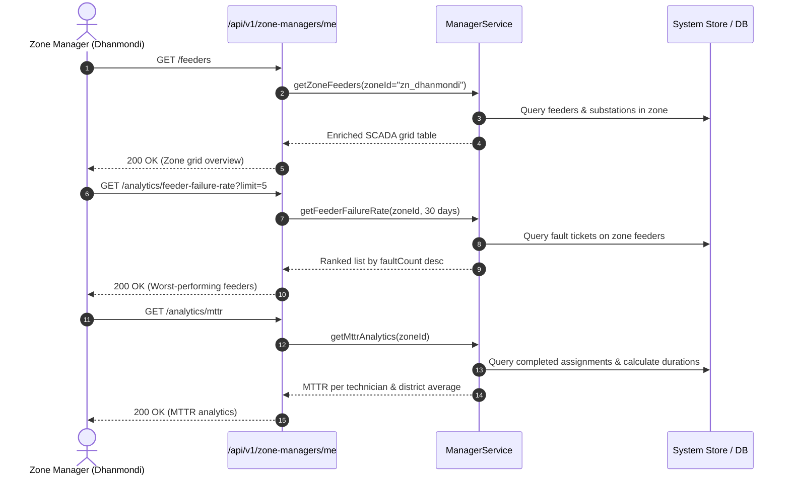
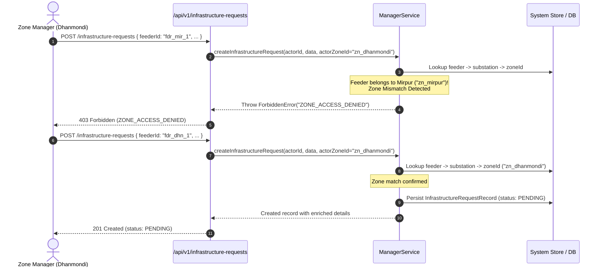

# Zone Manager APIs, Analytics, and Infrastructure Upgrade Requests (Phase 21)

---

## 1. Executive Summary

Phase 21 establishes the district operations command center and analytics platform for **Zone Managers** (District Operations Chiefs) in the National Load Shedding & Power Outage Management System.

Zone Managers oversee district-level grid stability, monitor distribution feeder performance, manage field technician availability, evaluate empirical failure trends, and formally submit capital upgrade requests for chronic failing equipment to Grid Admins.

All capabilities are implemented across **Domain 8 (Endpoints 44–51 in `docs/api.md`)** under the canonical `/api/v1/zone-managers/me/*` route namespace (with backward-compatible aliases under `/api/zone-managers/me/*` and `/api/v1/manager/*`), strictly bound by horizontal zone scoping.

---

## 2. Core Architectural Pillars

```
                                      ┌─────────────────────────────────────────┐
                                      │             GRID ADMIN                  │
                                      └────────────────────┬────────────────────┘
                                                           │
                                   GET /api/v1/infrastructure-requests (Global View)
                                   PATCH /api/v1/infrastructure-requests/:id/status
                                                           │
                                                           ▼
┌────────────────────────────────────────────────────────────────────────────────────────────────────────┐
│                                    ZONE MANAGER OPERATIONS SUITE                                       │
│                                                                                                        │
│   ┌───────────────────────────────┐  Strict District Scoping  ┌─────────────────────────────────────┐   │
│   │  SCADA Grid Overview          │ ────────────────────────> │ Empirical Analytics                 │   │
│   │  • Live Feeder Status Badges  │                           │ • Feeder Failure Rate Ranking       │   │
│   │  • Connected Transformers     │                           │ • Technician Team MTTR              │   │
│   │  • Real-time Meter Counts     │                           │ • 30-Day Daily Deficit Shed (MWh)   │   │
│   └───────────────────────────────┘                           └─────────────────────────────────────┘   │
│                                                   │                                                     │
│                                                   ▼                                                     │
│                               ┌───────────────────────────────────────┐                                 │
│                               │  Infrastructure Upgrade Workflow      │                                 │
│                               │  • Zone-Scope Validation (feeder->zone)│                                │
│                               │  • Supporting Empirical Metrics       │                                 │
│                               │  • PENDING Upgrade Request Record     │                                 │
│                               └───────────────────────────────────────┘                                 │
└────────────────────────────────────────────────────────────────────────────────────────────────────────┘
                                                           ▲
                                                           │
                                   GET /api/v1/zone-managers/me/feeders (Endpoint 44)
                                   GET /api/v1/zone-managers/me/tickets (Endpoint 45)
                                   GET /api/v1/zone-managers/me/technicians (Endpoint 46)
                                   POST /api/v1/infrastructure-requests (Endpoint 50)
                                                           │
                                      ┌────────────────────┴────────────────────┐
                                      │              ZONE MANAGER               │
                                      └─────────────────────────────────────────┘
```

### 2.1 Horizontal Zone Boundary Enforcement
1. **Unassigned Manager Protection:**
   If a user authenticated with the `ZONE_MANAGER` role does not have an `assignedZoneId`, requests to `/zone-managers/me/*` fail immediately with:
   $$\text{HTTP } 400 \quad \text{code: } \texttt{ZONE\_NOT\_ASSIGNED}$$
2. **Zero Cross-District Data Leakage:**
   All queries for feeders, open outage tickets, technician rosters, and analytics are filtered by the manager's assigned zone:
   $$\forall e \in \text{Results}: \text{feederZone}(e) = \text{user.assignedZoneId}$$
3. **Upgrade Submission Guard:**
   When submitting an infrastructure upgrade request for a feeder, the system resolves $\text{Feeder} \to \text{Substation} \to \text{Zone}$. If the feeder does not belong to the Zone Manager's district (and the caller is not a global Admin), the request is rejected with:
   $$\text{HTTP } 403 \quad \text{code: } \texttt{ZONE\_ACCESS\_DENIED}$$

---

## 3. Canonical REST API Specifications (Domain 8: Endpoints 44–51)

### 3.1 Endpoint 44: SCADA Grid Table (`GET /api/v1/zone-managers/me/feeders`)
* **Role:** `ZONE_MANAGER`, `ADMIN`
* **Aliases:** `/api/zone-managers/me/dashboard`, `/api/v1/manager/grid`
* **Query Parameters:** `status` (`FeederStatus`), `search` (name or code), `substationId`, `page`, `pageSize`
* **Description:** Provides a sortable live SCADA grid data-table for the assigned zone.
* **Payload Structure:**
  ```json
  {
    "success": true,
    "data": {
      "zone": { "id": "zn_dhanmondi", "name": "Dhanmondi", "code": "DHN" },
      "totalFeeders": 4,
      "totalCapacityMW": 78,
      "onlineFeedersCount": 3,
      "faultFeedersCount": 1,
      "scheduledFeedersCount": 0,
      "feeders": [
        {
          "id": "fdr_dhn_1",
          "name": "Dhanmondi Road 27 Feeder",
          "code": "FDR-DHN-01",
          "capacityMW": 20,
          "isCritical": false,
          "status": "ONLINE",
          "substationName": "Dhanmondi 132/33kV Substation",
          "zoneName": "Dhanmondi",
          "connectedTransformersCount": 4,
          "connectedMetersCount": 12,
          "openTicketsCount": 0
        }
      ]
    }
  }
  ```

### 3.2 Endpoint 45: District Outage Tickets (`GET /api/v1/zone-managers/me/tickets`)
* **Role:** `ZONE_MANAGER`, `ADMIN`
* **Aliases:** `/api/v1/manager/outages`, `/api/zone-managers/me/tickets`
* **Query Parameters:** `status` (`OutageStatus`), `faultType`, `feederId`, `page`, `pageSize`
* **Description:** Returns all outage tickets within the manager's district with enriched feeder, customer, and dispatched technician details.

### 3.3 Endpoint 46: Technician Availability Roster (`GET /api/v1/zone-managers/me/technicians`)
* **Role:** `ZONE_MANAGER`, `ADMIN`
* **Aliases:** `/api/v1/manager/technicians`, `/api/zone-managers/me/technicians`
* **Query Parameters:** `isAvailable` (boolean), `search`
* **Description:** Lists field technicians stationed in the zone with active task counts and real-time availability:
  $$\text{isAvailable} = (\text{activeAssignmentsCount} < 3) \land (\text{user.status} = \text{ACTIVE})$$

### 3.4 Endpoint 47: Feeder Failure Rate Analytics (`GET /api/v1/zone-managers/me/analytics/feeder-failure-rate`)
* **Role:** `ZONE_MANAGER`, `ADMIN`
* **Query Parameters:** `from` (ISO datetime), `to` (ISO datetime), `limit` (default: 20)
* **Description:** Answers *"Which Feeder line fails the most often?"* Aggregates unexpected fault occurrences across the target date window (defaulting to the last 30 days) and ranks feeders descending by fault count.
* **Fields Returned:** `feederId`, `feederName`, `feederCode`, `substationName`, `capacityMW`, `faultCount`, `resolvedFaultCount`, `totalDowntimeMinutes`, `averageResolutionMinutes`, `lastFaultAt`.

### 3.5 Endpoint 48: Mean Time to Resolution (MTTR) (`GET /api/v1/zone-managers/me/analytics/mttr`)
* **Role:** `ZONE_MANAGER`, `ADMIN`
* **Aliases:** `/api/zone-managers/me/analytics/avg-resolution-time`
* **Query Parameters:** `technicianId`, `from`, `to`
* **Description:** Computes the average duration (in minutes) required for field crews to complete outage repairs:
  $$\text{durationMinutes} = \frac{t_{\text{completed}} - t_{\text{started}}}{60{,}000}$$
  $$\text{MTTR} = \frac{\sum \text{durationMinutes}}{\text{resolvedTicketsCount}}$$
* **Summary Metrics:** Returns `overallZoneMttrMinutes` for district benchmarking and per-technician breakdowns.

### 3.6 Endpoint 49: 30-Day Daily Deficit Shed (`GET /api/v1/zone-managers/me/analytics/daily-deficit`)
* **Role:** `ZONE_MANAGER`, `ADMIN`
* **Query Parameters:** `from`, `to`, `interval` (`daily`, `weekly`)
* **Description:** Aggregates load-shedding deficit (in MW) and total energy shed (in MWh) across all feeders belonging to the zone for each day in the date window.
* **Formulas:**
  $$\text{loadShedMWh} = \sum \left( \text{feederLoadMW} \times \frac{\Delta t_{\text{hours}}}{60} \right)$$
* **Outputs:** Continuous daily time-series array, `totalDeficitShedMW`, `totalLoadShedMWh`, `peakDeficitDate`, `peakDeficitMW`, and `averageDailyDeficitMW`.

### 3.7 Endpoint 50: Submit Infrastructure Upgrade Request (`POST /api/v1/infrastructure-requests`)
* **Role:** `ZONE_MANAGER`, `ADMIN`
* **Aliases:** `/api/infrastructure-requests`, `/api/v1/manager/upgrade-requests`
* **Request Body:**
  ```json
  {
    "feederId": "fdr_dhn_1",
    "reason": "Recurrent insulation breakdown and oil leak on Dhanmondi line 1",
    "proposedAction": "Replace primary 33kV vacuum circuit breaker and step-down transformer",
    "supportingMetrics": { "faultCount": 6, "mttrMinutes": 120 }
  }
  ```
* **Status Code:** `201 Created`

### 3.8 Endpoint 51: List Infrastructure Upgrade Requests (`GET /api/v1/infrastructure-requests`)
* **Role:** `ZONE_MANAGER`, `ADMIN`
* **Scoping:** Zone Managers only see requests from their district; Admins see all requests across the entire grid.

---

## 4. Sequence Diagrams

### 4.1 Zone Manager District SCADA & Analytics Flow



### 4.2 Infrastructure Upgrade Request Submission & Zone Boundary Gate



---

## 5. Verification Suite

Automated verification suite **Test 28** in [`apps/api/src/test/runner.ts`](file:///g:/programming/CSE-3110/Zarin-loadshading/apps/api/src/test/runner.ts) covers all Phase 21 requirements:

| Subtest | Description | Verification Criterion |
| :--- | :--- | :--- |
| **28a** | `GET /api/v1/zone-managers/me/feeders` | Returns SCADA grid table scoped to Dhanmondi with substation, meters, and open tickets |
| **28a** | Search Query Filter | `?search=road` filters feeder list by name and code |
| **28b** | `GET /api/v1/zone-managers/me/tickets` | Returns district tickets; strictly excludes Mirpur tickets (zero cross-zone leakage) |
| **28c** | `GET /api/v1/zone-managers/me/technicians` | Returns technician roster strictly stationed within the manager's assigned zone |
| **28d** | `GET /api/v1/zone-managers/me/analytics/feeder-failure-rate` | Returns ranked feeder failures with fault count and average resolution minutes |
| **28e** | `GET /api/v1/zone-managers/me/analytics/mttr` | Computes district MTTR and per-technician repair duration analytics |
| **28f** | `GET /api/v1/zone-managers/me/analytics/daily-deficit` | Aggregates daily power deficit time-series and calculates total load shed MWh |
| **28g** | Cross-Zone Upgrade Rejection | Submitting upgrade request for a feeder outside manager's zone is rejected (`403 ZONE_ACCESS_DENIED`) |
| **28g** | In-Zone Upgrade Submission | Submitting upgrade request for an in-zone feeder succeeds with `201 Created` (`status: PENDING`) |
| **28h** | List Upgrades Scoping | Zone Manager only sees requests for their district; global Admin sees all grid requests |

**Test Suite Execution Result:** 253 passed, 0 failed.
